# Does the Heckscher-Ohlin model survive the data?

**ECON 561 · guided empirical lab in Stata (about 50 minutes)**

In class we proved four results for the 2×2 HO model: the **HO theorem**, **factor price equalization (FPE)**, **Stolper-Samuelson (SS)** and **Rybczynski**. We also said that factor intensity is a property of *technology*, not of a country. Today we take each one to real data. For every result we will do what an empirical economist does:

1. State the prediction in words a dataset can check.
2. Pick a **data proxy** for each object in the model.
3. Make a picture **before** running a regression.
4. Run the regression and read the number.
5. Decide: does the theory survive, fail, or survive with an asterisk?

None of these exhibits is a causal estimate. They are **tests of predictions**: patterns the model says we *must* see if it is right. A model can survive a test without being proven, and it can fail a test because the proxy is poor. Part of the job is telling those apart.

## Class route

| Minutes | Section | Theory result | Data |
| --- | --- | --- | --- |
| 0–5 | 0. Setup | | Download three datasets |
| 5–10 | 1. Endowments | Who is capital abundant? | Penn World Table |
| 10–17 | 2. FPE | Trade equalizes factor prices | Penn World Table |
| 17–30 | 3. HO theorem | K-abundant countries export K-intensive goods | BACI trade + PWT |
| 30–37 | 4. Rybczynski | More K → output shifts to K-intensive goods | BACI + PWT, 1995–2015 |
| 37–42 | 5. Factor intensity | Intensity is a property of technology | NBER-CES (US industries) |
| 42–50 | 6. Stolper-Samuelson | Relative goods prices drive relative factor prices | NBER-CES |

**How to work together.** Open Stata and the Do-file Editor. Paste each code block below into your do-file **in order** and run one whole block at a time (select it, then **Do**). Or open [ho_empirics_lab.do](ho_empirics_lab.do), which has the same blocks. Blocks that start with `preserve` must run together through their `restore`. The figures on this page are the reference results; your run saves the same figures in `output/`.

Works in Stata 16 or newer, uses only built-in commands, and needs an internet connection for section 0.

## The data and the proxies

| Model object | Data proxy | Source |
| --- | --- | --- |
| Capital endowment $K$ | Capital stock at current PPPs (`cn`) | Penn World Table 10.01 |
| Labor endowment $L$ | Persons engaged (`emp`) | Penn World Table 10.01 |
| Wage $w$ | Labor share × GDP / workers (`labsh*cgdpo/emp`) | Penn World Table 10.01 |
| Capital-intensive good | HS chapters 28–40, 47–49, 72–92: chemicals, plastics, paper, metals, machinery, vehicles, instruments | BACI (CEPII), HS92 |
| Labor-intensive good | HS chapters 41–43, 46, 50–67, 94–96: leather, textiles, apparel, footwear, furniture, toys | BACI (CEPII), HS92 |
| Skilled vs unskilled labor | Nonproduction vs production workers | NBER-CES Manufacturing Database |
| Goods price $p$ | Shipments deflator (`piship`) | NBER-CES |
| Capital intensity of an industry | Real capital per worker (`cap/emp`) | NBER-CES |

The trade file `ho_trade_intensity.csv` is small (4,404 rows: country × year × group). I built it from the full BACI files, about 700 MB, with [build_ho_trade.do](build_ho_trade.do), so you can see exactly how. Natural-resource goods (food, fuels, minerals, wood) are left out on purpose: the 2×2 model has no land or oil.

## 0. Setup

```stata
* ----- 0. Setup and data -----
version 16.0
clear all
set more off
set scheme s1color
capture mkdir output
capture log close holab
log using "output/ho_lab.log", text replace name(holab)

* Penn World Table 10.01: capital stocks, workers, wages for 183 countries (1950-2019)
capture confirm file "pwt1001.dta"
if _rc copy "https://dataverse.nl/api/access/datafile/354098" "pwt1001.dta"

* Trade by factor-intensity group (built from CEPII BACI with build_ho_trade.do)
global trade "https://raw.githubusercontent.com/yang-liang/econ-coding-lab/main/data/ho_trade_intensity.csv"
* If you downloaded the csv instead, use:  global trade "ho_trade_intensity.csv"

* NBER-CES Manufacturing Database: 473 US industries, 1958-2018
global nberces "https://data.nber.org/nberces/nberces5818v1/nberces5818v1_n1997.dta"
```

**Stata translation.** `copy` downloads a file to your working folder once; `capture confirm file` skips the download if you already have it. A `global` stores text we reuse, here a web address. `import delimited` and `use` can read straight from a URL.

## 1. Who is capital abundant?

HO starts from **relative** endowments. A country is capital abundant if its $K/L$ is above its trading partners', so we divide each country's $K/L$ by the world's.

```stata
* ----- 1. Who is capital abundant? (Penn World Table) -----
use countrycode country year cn emp pop hc labsh cgdpo using "pwt1001.dta", clear
rename countrycode iso3
gen double kl   = cn/emp/1000                       // capital per worker, $1,000 (2017 PPP)
gen double wage = labsh*cgdpo/emp/1000              // labor income per worker, $1,000
bysort year: egen double world_k = total(cn*(emp<.)) if cn<. & emp<.
bysort year: egen double world_l = total(emp)        if cn<. & emp<.
gen double rel_kl = kl/(world_k/world_l/1000)       // 1 = world average K/L
gen ln_kl     = ln(kl)
gen ln_rel_kl = ln(rel_kl)
gen ln_wage   = ln(wage)
label var rel_kl "K/L relative to world (world = 1)"
save "output/pwt_clean.dta", replace
```

**Stata translation.** `bysort year: egen total()` adds up capital and workers across all countries in the same year, which gives world $K/L$.

```stata
* Exhibit 1: relative capital abundance in 2015
graph hbar rel_kl if year==2015 & inlist(iso3,"USA","DEU","JPN","KOR","GBR","MEX","BRA") | ///
    year==2015 & inlist(iso3,"CHN","TUR","IDN","IND","VNM","BGD","NGA","ETH"), ///
    over(country, sort(1) descending label(labsize(small))) ///
    yline(1, lcolor(maroon) lpattern(dash)) blabel(bar, format(%4.1f) size(vsmall)) ///
    ytitle("Capital per worker relative to world average") ///
    title("Exhibit 1. Relative factor endowments, 2015", size(medium)) ///
    note("Source: Penn World Table 10.01 (cn/emp). Dashed line = world average.")
graph export "output/E01_endowments_2015.png", width(1800) replace
```

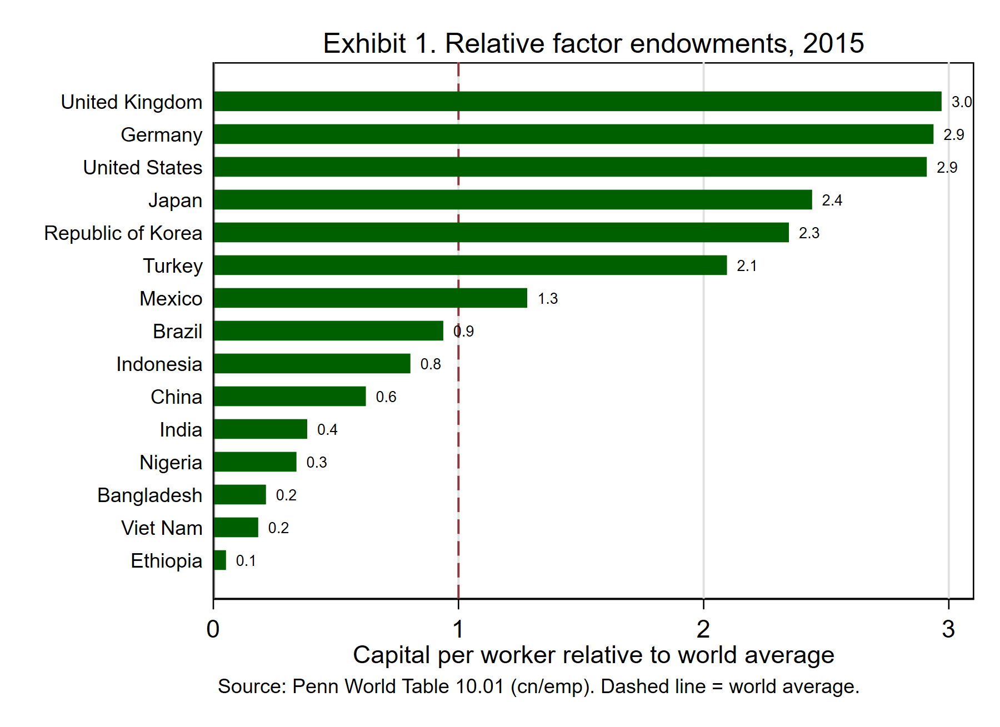

**What we see.** The UK, Germany and the US have about 3 times the world's capital per worker. China is at 0.6, India 0.4, Vietnam and Bangladesh 0.2. HO predicts the top of this chart exports capital-intensive goods and the bottom exports labor-intensive goods.

```stata
* Exhibit 2: endowments move over time
twoway (line rel_kl year if iso3=="USA", lwidth(medthick)) ///
       (line rel_kl year if iso3=="KOR", lwidth(medthick)) ///
       (line rel_kl year if iso3=="CHN", lwidth(medthick)) ///
       (line rel_kl year if iso3=="MEX", lwidth(medthick) lpattern(dash)) ///
       (line rel_kl year if iso3=="IND", lwidth(medthick) lpattern(dash)) ///
       (line rel_kl year if iso3=="VNM", lwidth(medthick) lpattern(dash)) ///
       if year>=1970, yscale(log) ylabel(.1 .25 .5 1 2 4, angle(0)) yline(1, lcolor(gs10)) ///
       legend(order(1 "USA" 2 "Korea" 3 "China" 4 "Mexico" 5 "India" 6 "Vietnam") rows(1) size(small)) ///
       ytitle("K/L relative to world (log scale)") xtitle("") ///
       title("Exhibit 2. Endowments are not fixed: capital deepening, 1970-2019", size(medium))
graph export "output/E02_endowments_over_time.png", width(1800) replace
```

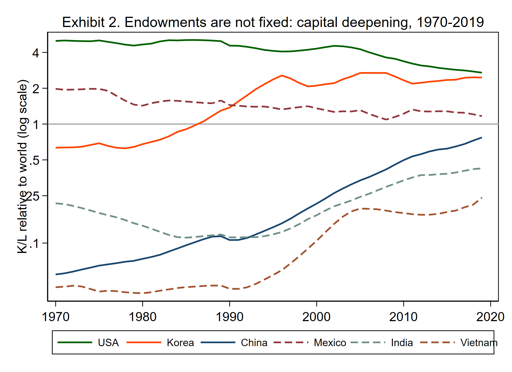

**What we see.** Endowments are not fixed. Korea went from half the world's $K/L$ in 1970 to more than twice it. China rose about tenfold relative to the world. The US *fell* relative to the world because everyone else accumulated capital faster. This is the variation Rybczynski is about (section 4).

## 2. Factor price equalization

**Prediction.** With free trade, identical technologies and both countries diversified, trade in goods equalizes $w$ and $r$ across countries, even though workers never move.

```stata
* ----- 2. Factor price equalization: do trading countries pay the same wage? -----
* Exhibit 3: wage levels vs endowments, 2019
gen lab3 = ""
foreach c in USA DEU JPN KOR CHN MEX IND VNM BGD BRA TUR IDN {
    replace lab3 = iso3 if iso3=="`c'"
}
twoway (scatter ln_wage ln_rel_kl if year==2019 & pop>=1, msize(small) mcolor(navy%40)) ///
       (scatter ln_wage ln_rel_kl if year==2019 & pop>=1 & lab3!="", msize(small) mcolor(maroon) ///
            mlabel(lab3) mlabsize(vsmall) mlabcolor(maroon)) ///
       (lfit ln_wage ln_rel_kl if year==2019 & pop>=1, lcolor(black)), ///
       ylabel(, angle(0)) legend(off) xtitle("ln K/L relative to world") ytitle("ln labor income per worker ($1,000 PPP)") ///
       title("Exhibit 3. Factor prices are far from equal", size(medium)) ///
       note("FPE predicts a flat line: one world wage. Each dot is a country (population 1m+).")
graph export "output/E03_fpe_wages.png", width(1800) replace
regress ln_wage ln_rel_kl if year==2019 & pop>=1, robust
```

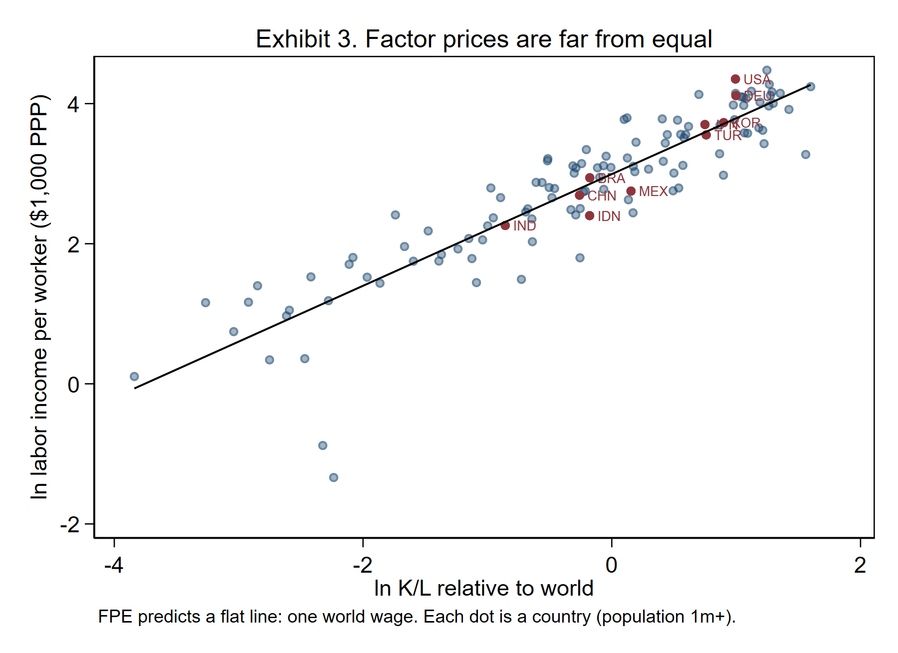

**Result.** The slope is **0.80** (robust SE 0.05, $R^2=0.81$, 121 countries). A country with 10% more capital per worker pays about 8% more per worker. FPE predicts a flat line; the data show a steep one.

```stata
* Exhibit 4: has globalization compressed wage gaps?  Fixed panel of countries since 1970
preserve
keep if year>=1970 & ln_wage<. & pop>=1
bysort iso3: gen nyrs = _N
keep if nyrs==50
collapse (sd) sd_lnw=ln_wage (p90) p90=ln_wage (p10) p10=ln_wage (count) n=ln_wage, by(year)
gen gap9010 = exp(p90-p10)
list year n sd_lnw gap9010 if inlist(year,1970,1980,1990,2000,2010,2019), noobs
twoway (line gap9010 year, lwidth(medthick)), ///
       ytitle("90th / 10th percentile wage ratio") ylabel(, angle(0)) xtitle("") ///
       title("Exhibit 4. Cross-country wage gap, fixed set of countries", size(medium)) ///
       note("Ratio of labor income per worker, 90th vs 10th percentile country.")
graph export "output/E04_fpe_dispersion.png", width(1800) replace
restore
```

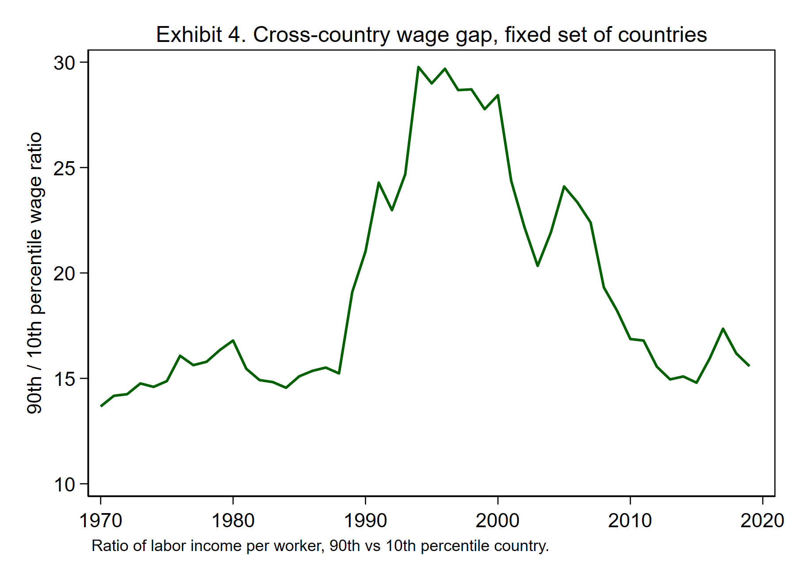

**Result.** For the same 79 countries, the 90th-percentile country paid **13.7** times the 10th-percentile country in 1970, **28.4** times in 2000 and **15.6** times in 2019. Wage gaps widened and then narrowed during the most open period in history, but they are still enormous.

**Check the data before you interpret.** The jump around 1990 is not globalization. It comes from a few countries whose measured labor income collapsed: Nigeria (a measured fall of 90%, most likely a revision to its labor-share series), Iraq, Rwanda and Lebanon (wars), and Zambia and Tanzania. A good empirical economist finds out *which* observations drive a pattern before telling a story about it.

**Discuss.** Which FPE assumption fails? Candidates: technologies differ across countries (Trefler 1995: once you adjust for productivity, a lot of the gap closes), countries are not diversified (they sit in different "cones"), trade is not free, and workers differ in skill (`hc`).

## 3. The HO theorem

**Prediction.** The capital-abundant country exports the capital-intensive good. Across countries, the share of capital-intensive goods in exports, and *net* exports of those goods, should rise with relative $K/L$.

```stata
* ----- 3. The HO theorem: do capital-abundant countries export capital-intensive goods? -----
import delimited "$trade", clear
keep if inlist(group,"CAP","LAB")
reshape wide exports imports, i(iso3 year) j(group) string
merge 1:1 iso3 year using "output/pwt_clean.dta", keep(match) nogen ///
    keepusing(country pop kl rel_kl ln_kl ln_rel_kl wage ln_wage)
gen mx        = exportsCAP + exportsLAB
gen cap_share = exportsCAP/mx                                   // capital-intensive share of mfg exports
gen nx_cap    = (exportsCAP-importsCAP)/(exportsCAP+importsCAP) // net export ratio, -1 to 1
gen nx_lab    = (exportsLAB-importsLAB)/(exportsLAB+importsLAB)
keep if pop>=1 & mx>=1000                                       // 1m+ people, $1bn+ mfg exports
gen lab3 = ""
foreach c in USA DEU JPN KOR CHN MEX IND VNM BGD BRA TUR IDN PAK ITA {
    replace lab3 = iso3 if iso3=="`c'"
}
encode iso3, gen(cid)
save "output/ho_panel.dta", replace
```

**Stata translation.** `reshape wide` turns the four rows per country-year (one per good group) into one row with columns `exportsCAP`, `exportsLAB`, and so on. `merge 1:1` attaches each country's endowment; `keep(match)` keeps only countries found in both files. We drop very small economies because a few large plants can swing their export mix.

```stata
* Exhibit 5: export composition vs endowment, 2015
twoway (scatter cap_share ln_rel_kl if year==2015, msize(small) mcolor(navy%40)) ///
       (scatter cap_share ln_rel_kl if year==2015 & lab3!="", msize(small) mcolor(maroon) ///
            mlabel(lab3) mlabsize(vsmall) mlabcolor(maroon)) ///
       (lfit cap_share ln_rel_kl if year==2015, lcolor(black)), ///
       legend(off) ylabel(0(.2)1, angle(0)) xtitle("ln K/L relative to world") ///
       ytitle("Capital-intensive share of manufactured exports") ///
       title("Exhibit 5. Capital-abundant countries export capital-intensive goods", size(medium)) ///
       note("Capital-intensive: chemicals, plastics, paper, metals, machinery, vehicles, instruments." ///
            "Labor-intensive: leather, textiles, apparel, footwear, furniture, toys. Source: BACI 2015, PWT.")
graph export "output/E05_ho_export_share.png", width(1800) replace
regress cap_share ln_rel_kl if year==2015, robust
```

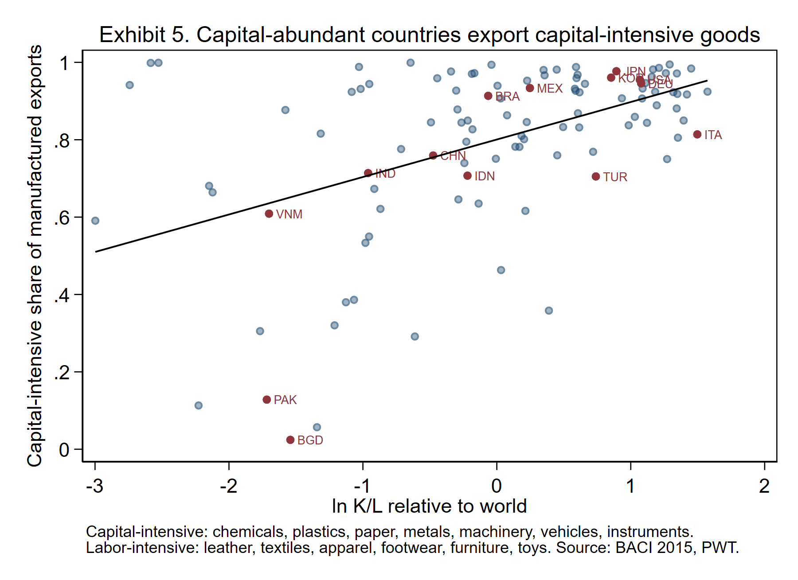

**Result.** Slope **0.097** (robust SE 0.024, $t=4.0$, 107 countries). Moving from India's endowment to the US's (about 2.1 log points) raises the capital-intensive export share by about 20 percentage points. Bangladesh and Pakistan export almost nothing *but* apparel and textiles. Japan, Korea, Germany and the US export almost nothing *but* machinery, vehicles and chemicals.

**Discuss.** Why is China at 0.76, far above Vietnam and India? HS 85 (electronics) counts as capital intensive, but much of what China and Vietnam do in electronics is *assembly*, the labor-intensive stage of a capital-intensive product. Product categories are a rough proxy for factor content.

```stata
* Exhibit 6: the cleaner test uses net exports (exports minus imports) in each group
twoway (scatter nx_cap ln_rel_kl if year==2015, msize(small) mcolor(navy%50)) ///
       (lfit nx_cap ln_rel_kl if year==2015, lcolor(navy) lwidth(medthick)) ///
       (scatter nx_lab ln_rel_kl if year==2015, msize(small) msymbol(Th) mcolor(maroon%60)) ///
       (lfit nx_lab ln_rel_kl if year==2015, lcolor(maroon) lwidth(medthick) lpattern(dash)), ///
       yline(0, lcolor(gs10)) ylabel(-1(.5)1, angle(0)) ///
       legend(order(1 "Capital-intensive goods" 3 "Labor-intensive goods") rows(1)) ///
       xtitle("ln K/L relative to world") ytitle("Net export ratio (X-M)/(X+M)") ///
       title("Exhibit 6. Net trade by factor content of goods, 2015", size(medium))
graph export "output/E06_ho_net_exports.png", width(1800) replace
regress nx_cap ln_rel_kl if year==2015, robust
regress nx_lab ln_rel_kl if year==2015, robust
```

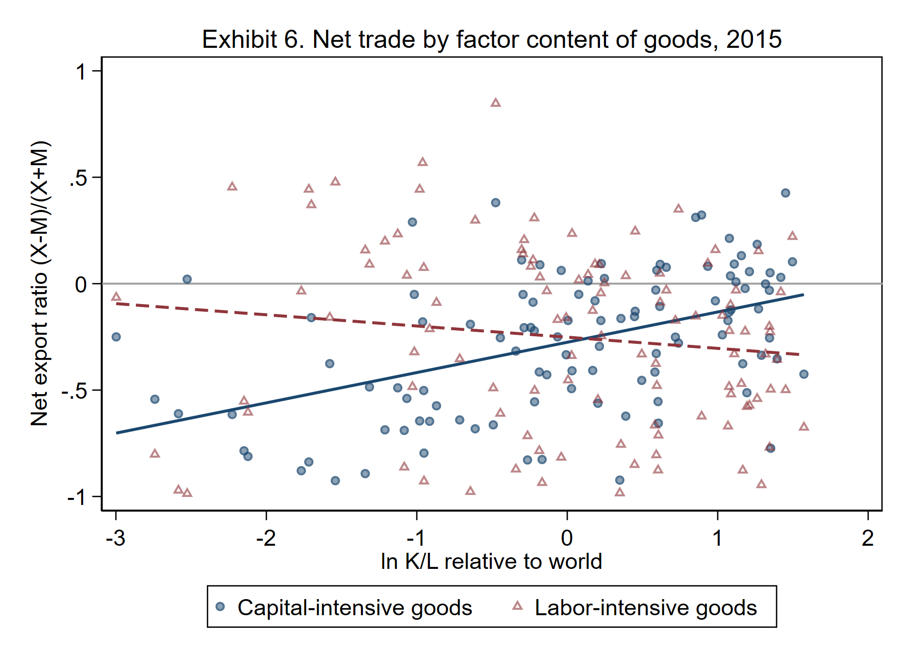

**Result.** Net exports of capital-intensive goods rise with $K/L$: slope **0.142** (SE 0.028). Net exports of labor-intensive goods fall with $K/L$ as predicted, but the slope is small and imprecise: **−0.053** (SE 0.043, $p=0.22$).

**Discuss.** HO is a theorem about *net* trade. Why is the labor-intensive slope so weak? Rich countries both import and export apparel (Italian fashion, US branded goods), and many poor countries import fabric to sew into clothing. This is intra-industry trade, which the 2×2 model cannot produce and Krugman's model can.

```stata
* Exhibit 7: does the HO slope hold every year?
tempname h
postfile `h' year b lo hi n using "output/ho_slopes.dta", replace
foreach y in 1995 2000 2005 2010 2015 {
    quietly regress cap_share ln_rel_kl if year==`y', robust
    post `h' (`y') (_b[ln_rel_kl]) (_b[ln_rel_kl]-invttail(e(df_r),.025)*_se[ln_rel_kl]) ///
        (_b[ln_rel_kl]+invttail(e(df_r),.025)*_se[ln_rel_kl]) (e(N))
}
postclose `h'
preserve
use "output/ho_slopes.dta", clear
list, noobs
twoway (rcap lo hi year, lcolor(navy)) (scatter b year, mcolor(navy) msize(large)), ///
       yline(0, lcolor(maroon) lpattern(dash)) xlabel(1995(5)2015) ylabel(, angle(0)) legend(off) ///
       ytitle("Slope of K-intensive export share on ln K/L") xtitle("") ///
       title("Exhibit 7. The HO slope, year by year (95% CI)", size(medium))
graph export "output/E07_ho_slope_by_year.png", width(1800) replace
restore
```

**Stata translation.** `postfile` opens an empty results dataset; each `post` adds one row (year, slope, 95% CI). This is how you turn 5 regressions into one picture.

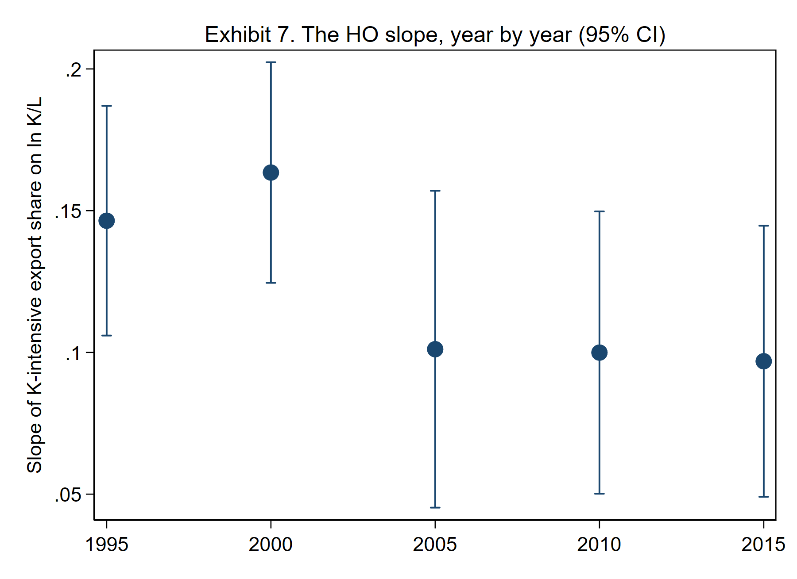

**Result.** The slope is positive and significant in every year: 0.146 (1995), 0.163 (2000), 0.101 (2005), 0.100 (2010), 0.097 (2015). It shrinks over time as global supply chains spread "capital-intensive" product codes into labor-abundant countries.

## 4. Rybczynski

**Prediction.** At fixed goods prices, an increase in $K$ raises output of the capital-intensive good and *lowers* output of the labor-intensive good. A country that accumulates capital should shift its production, and so its exports, toward capital-intensive goods.

```stata
* ----- 4. Rybczynski: when K/L grows, does the output mix shift toward K-intensive goods? -----
* Exhibit 8: trajectories of export composition
twoway (connected cap_share year if iso3=="CHN", lwidth(medthick)) ///
       (connected cap_share year if iso3=="KOR", lwidth(medthick)) ///
       (connected cap_share year if iso3=="VNM", lwidth(medthick)) ///
       (connected cap_share year if iso3=="IND", lwidth(medthick) lpattern(dash)) ///
       (connected cap_share year if iso3=="BGD", lwidth(medthick) lpattern(dash)) ///
       (connected cap_share year if iso3=="USA", lwidth(medthick) lpattern(dash)), ///
       ylabel(0(.2)1, angle(0)) xlabel(1995(5)2015) ///
       legend(order(1 "China" 2 "Korea" 3 "Vietnam" 4 "India" 5 "Bangladesh" 6 "USA") rows(1) size(small)) ///
       ytitle("Capital-intensive share of mfg exports") xtitle("") ///
       title("Exhibit 8. Export mix as countries accumulate capital", size(medium))
graph export "output/E08_rybczynski_paths.png", width(1800) replace
```

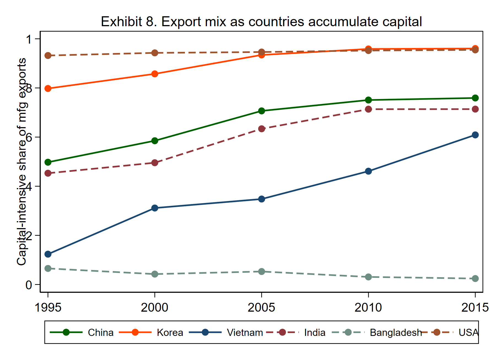

**What we see.** Vietnam: 0.12 → 0.61. China: 0.50 → 0.76. India: 0.45 → 0.71. Korea: 0.80 → 0.96. Bangladesh, whose capital per worker stayed very low, stayed at almost all apparel.

```stata
* Exhibit 9: long difference 1995-2015, one dot per country
preserve
keep if inlist(year,1995,2015)
bysort iso3 (year): keep if _N==2
bysort iso3 (year): gen d_share = cap_share[2]-cap_share[1]
bysort iso3 (year): gen d_lnkl  = ln_kl[2]-ln_kl[1]
keep if year==2015
twoway (scatter d_share d_lnkl, msize(small) mcolor(navy%40)) ///
       (scatter d_share d_lnkl if lab3!="", msize(small) mcolor(maroon) mlabel(lab3) mlabsize(vsmall) mlabcolor(maroon)) ///
       (lfit d_share d_lnkl, lcolor(black)), ///
       yline(0, lcolor(gs10)) ylabel(, angle(0)) legend(off) ///
       xtitle("Change in ln K/L, 1995-2015") ytitle("Change in K-intensive export share") ///
       title("Exhibit 9. Rybczynski in long differences", size(medium))
graph export "output/E09_rybczynski_longdiff.png", width(1800) replace
regress d_share d_lnkl, robust
restore

* Same idea with all five years: country and year fixed effects
xtset cid year
xtreg cap_share ln_kl i.year, fe vce(cluster cid)
```

**Stata translation.** A **long difference** compares each country with itself 20 years apart, which removes everything about a country that does not change (geography, language, institutions). `xtreg, fe` does the same with all five years, and `i.year` removes shocks common to all countries in a year.

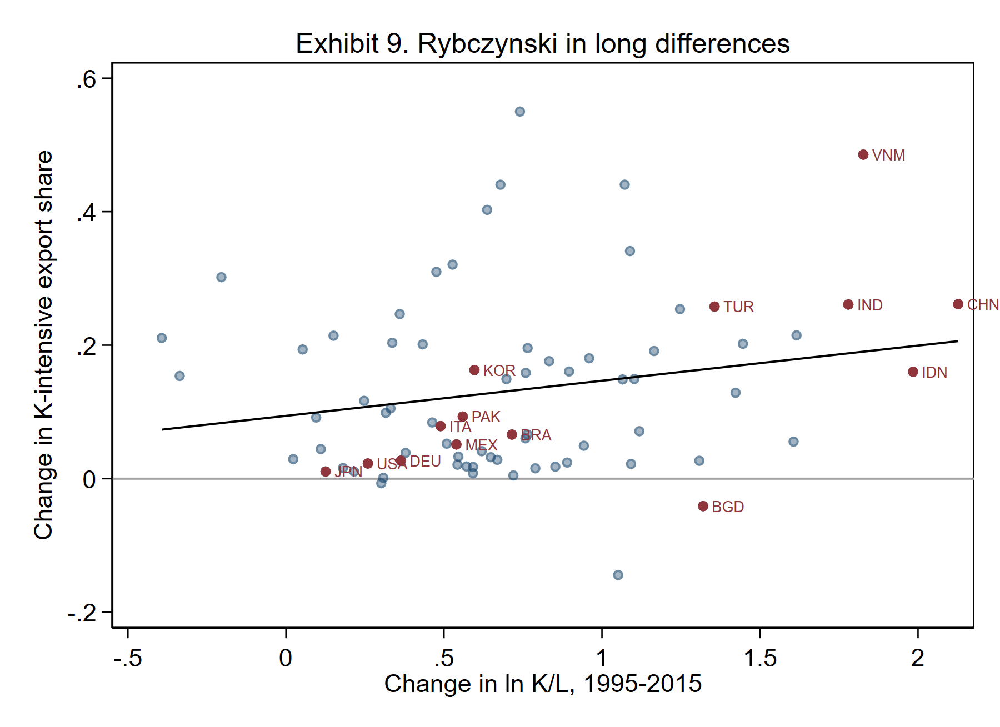

**Result.** Long difference: slope **0.053** (SE 0.028, $p=0.07$, 75 countries). The intercept is 0.094: almost *every* country shifted toward capital-intensive exports, whatever happened to its own $K/L$. With country and year fixed effects the slope is **0.019** (SE 0.020), not distinguishable from zero.

**Discuss.** The cross-country picture (Exhibit 5) is strong; the within-country evidence is weak once we remove the world trend. Why? (i) Rybczynski holds goods prices fixed, but they changed a lot. (ii) Exports are not output. (iii) Twenty years may be too short, or the HS proxy too coarse. This is a common pattern in empirical work: the *level* relationship is clear, the *change* relationship is noisy.

## 5. Factor intensity is a property of technology

**Model assumption.** Footballs are capital intensive *at every* $w/r$. In the data we can check that industries differ a lot in $K/L$ and that the ranking is stable, so that "capital-intensive good" means something.

```stata
* ----- 5. Factor intensity is a property of technology (US manufacturing) -----
use "$nberces", clear
gen naics3 = floor(naics/1000)
label define n3 311 "Food" 312 "Beverage & tobacco" 313 "Textile mills" 314 "Textile products" ///
    315 "Apparel" 316 "Leather" 321 "Wood" 322 "Paper" 323 "Printing" 324 "Petroleum & coal" ///
    325 "Chemicals" 326 "Plastics & rubber" 327 "Nonmetallic minerals" 331 "Primary metals" ///
    332 "Fabricated metals" 333 "Machinery" 334 "Computers & electr." 335 "Electrical equipment" ///
    336 "Transportation equip." 337 "Furniture" 339 "Miscellaneous"
label values naics3 n3
gen kl         = cap/emp                       // real capital per worker, $1,000 (1997 $)
gen skill      = (emp-prode)/emp               // nonproduction share of employment
save "output/nberces_clean.dta", replace
```

```stata
* Exhibit 10: capital per worker by sector, 2015
preserve
keep if year==2015
collapse (sum) cap emp, by(naics3)
gen kl = cap/emp
graph hbar kl, over(naics3, sort(1) descending label(labsize(small))) ///
    blabel(bar, format(%4.0f) size(vsmall)) ytitle("Real capital per worker ($1,000)") ///
    title("Exhibit 10. Capital per worker by US manufacturing sector, 2015", size(medium))
graph export "output/E10_kl_by_sector.png", width(1800) replace
restore
```

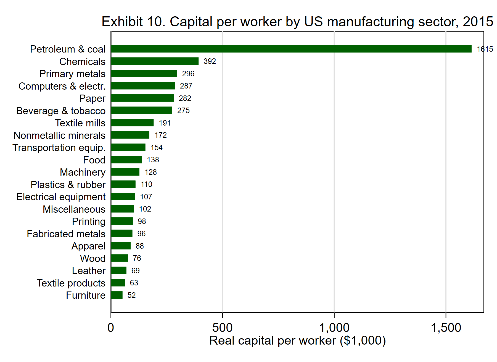

**What we see.** A petroleum refinery worker works with **$1.6 million** of capital; a furniture or apparel worker with **$50,000–90,000**. That is a factor of 20 to 30.

```stata
* Exhibit 11: the ranking is stable over 40 years (no factor-intensity reversals in time)
preserve
keep if inlist(year,1970,2010)
keep naics year kl emp
reshape wide kl emp, i(naics) j(year)
gen ln70 = ln(kl1970)
gen ln10 = ln(kl2010)
spearman kl1970 kl2010
local rho : display %4.2f r(rho)
twoway (scatter ln10 ln70, msize(vsmall) mcolor(navy%40)) ///
       (function y=x, range(1 7) lcolor(maroon) lpattern(dash)), ///
       ylabel(, angle(0)) legend(off) xtitle("ln capital per worker, 1970") ytitle("ln capital per worker, 2010") ///
       title("Exhibit 11. Capital-intensive industries stay capital intensive", size(medium)) ///
       note("Each dot is a 6-digit industry. Dashed = 45-degree line. Spearman rank correlation = `rho'.")
graph export "output/E11_kl_rank_stability.png", width(1800) replace
restore
```

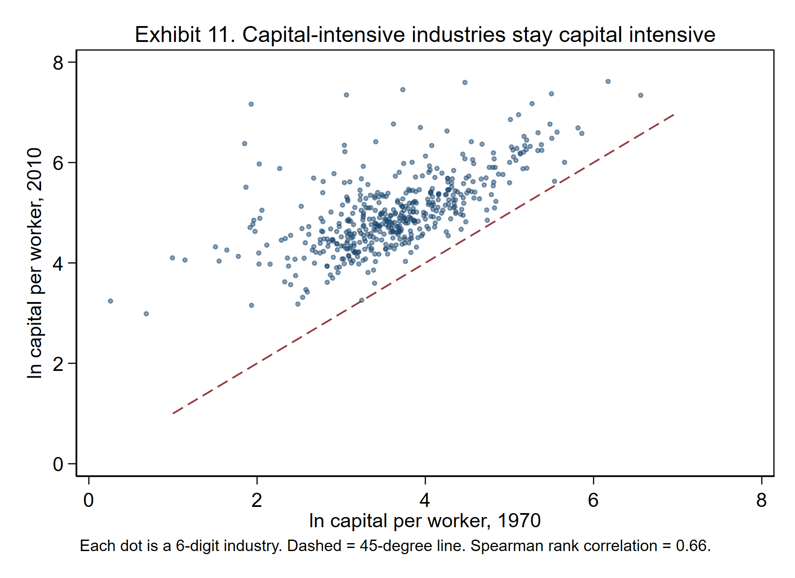

**Result.** Across 469 six-digit industries, the Spearman rank correlation of $K/L$ between 1970 and 2010 is **0.66**. Capital-intensive industries in 1970 are still capital intensive in 2010, even though $w/r$ changed a lot. Reversals are rare. (A true factor-intensity-reversal test would compare the same industry *across countries*.)

## 6. Stolper-Samuelson

**Prediction.** A rise in the relative price of a good raises the real return of the factor used intensively in it and lowers the real return of the other factor. Applied to the US after 1980: if trade with labor-abundant countries raised the US skill premium, it must have done so by **lowering the prices of unskilled-intensive goods relative to skill-intensive goods**. No relative price change, no SS effect.

```stata
* ----- 6. Stolper-Samuelson: skill premium and goods prices -----
* Exhibit 12: the skill premium and relative skilled employment both rose after 1980
preserve
collapse (sum) emp prode pay prodw, by(year)
gen rel_wage = ((pay-prodw)/(emp-prode)) / (prodw/prode)
gen rel_emp  = (emp-prode)/prode
list year rel_wage rel_emp if inlist(year,1960,1970,1980,1990,2000,2010,2018), noobs
twoway (line rel_wage year, lwidth(medthick)) ///
       (line rel_emp year, yaxis(2) lwidth(medthick) lpattern(dash)), ///
       xline(1980, lcolor(gs10)) ylabel(, angle(0)) xtitle("") ///
       ytitle("Nonproduction / production wage", axis(1)) ytitle("Nonproduction / production workers", axis(2)) ///
       legend(order(1 "Relative wage (left)" 2 "Relative employment (right)") rows(1)) ///
       title("Exhibit 12. US manufacturing: price and quantity of skill both rose", size(medium))
graph export "output/E12_skill_premium.png", width(1800) replace
restore
```

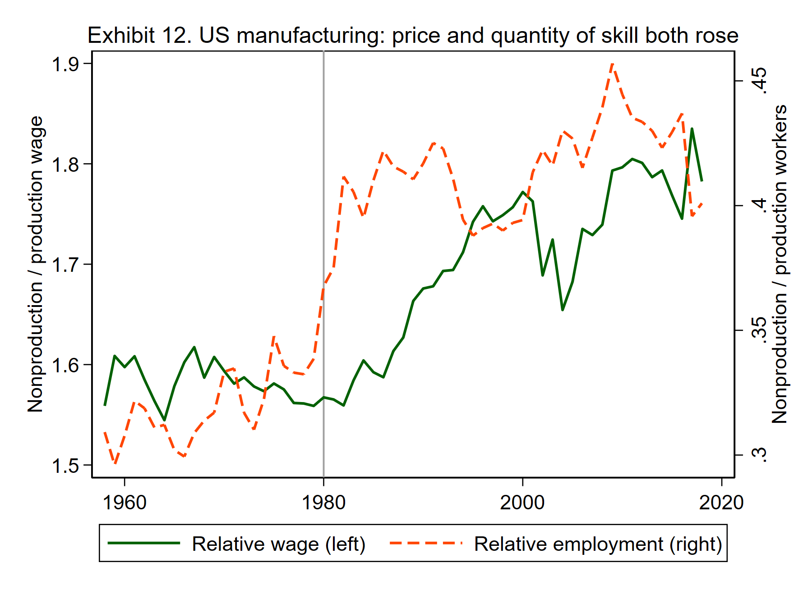

**What we see.** The nonproduction/production wage ratio was flat at about 1.57 until 1980, then rose to **1.77** by 2000. Over the same period relative *employment* of nonproduction workers also rose (0.37 → 0.39, peaking above 0.45). The price of skill and the quantity of skill went up together, which means *demand* for skill rose.

```stata
* Exhibit 13: the Lawrence-Slaughter price test, 1979-1999
* SS: if trade raised the skill premium, skill-intensive goods' prices must have risen relative
* to unskilled-intensive goods' prices. Effective price adds TFP growth (Leamer 1998).
preserve
keep if inlist(year,1979,1999)
keep naics naics3 year piship tfp5 skill emp
reshape wide piship tfp5 skill emp, i(naics) j(year)
gen dlnp   = 100*(ln(piship1999)-ln(piship1979))
gen dlneff = dlnp + 100*(ln(tfp51999)-ln(tfp51979))
drop if dlnp==. | skill1979==.
twoway (scatter dlnp skill1979 [aw=emp1979] if naics3!=334, msymbol(Oh) mcolor(navy%40)) ///
       (scatter dlnp skill1979 [aw=emp1979] if naics3==334, msymbol(Oh) mcolor(orange)) ///
       (lfit dlnp skill1979 [aw=emp1979], lcolor(gs8) lpattern(dash)) ///
       (lfit dlnp skill1979 [aw=emp1979] if naics3!=334, lcolor(navy) lwidth(medthick)), ///
       legend(order(2 "Computers & electronics" 3 "Fit, all" 4 "Fit, excl. computers") rows(1) size(vsmall)) ///
       ylabel(, angle(0)) xtitle("Nonproduction share of employment, 1979") ytitle("Price change, 1979-99 (log points)") ///
       title("Raw goods prices", size(medium)) name(ss1, replace)
twoway (scatter dlneff skill1979 [aw=emp1979], msymbol(Oh) mcolor(maroon%40)) ///
       (lfit dlneff skill1979 [aw=emp1979], lcolor(maroon) lwidth(medthick)), ///
       ylabel(, angle(0)) legend(off) xtitle("Nonproduction share of employment, 1979") ytitle("Price + TFP change (log points)") ///
       title("Effective prices (price + TFP)", size(medium)) name(ss2, replace)
graph combine ss1 ss2, cols(2) xsize(12) ysize(5.5) iscale(.8) ///
    title("Exhibit 13. Did skill-intensive goods get relatively more expensive?", size(medium)) ///
    note("Each circle is a 6-digit industry, sized by 1979 employment.")
graph export "output/E13_ss_price_test.png", width(2200) replace
regress dlnp   skill1979 [aw=emp1979], robust
regress dlnp   skill1979 [aw=emp1979] if naics3!=334, robust      // drop computers
regress dlneff skill1979 [aw=emp1979], robust
regress dlneff skill1979 [aw=emp1979] if naics3!=334, robust
restore
```

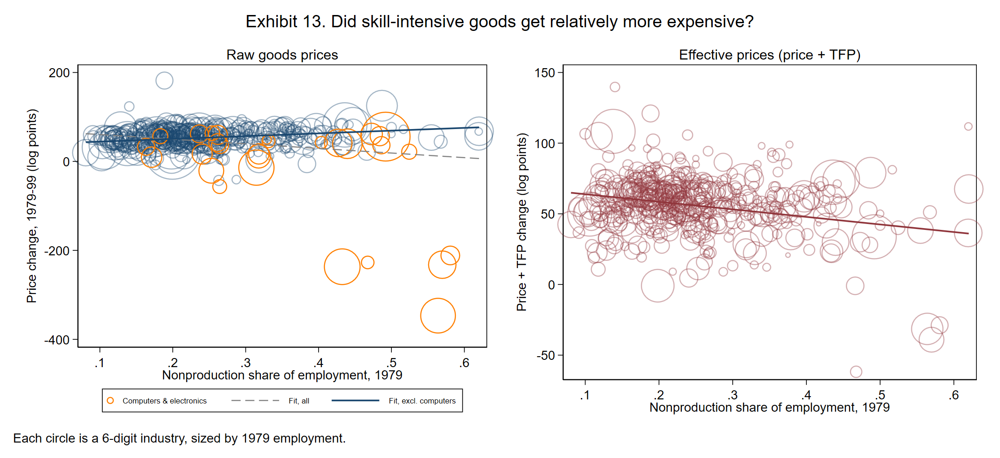

**Result** (weighted by 1979 employment, robust SEs, 469 industries):

| Dependent variable, 1979–99 | Slope on 1979 skill share | SE | Reading |
| --- | ---: | ---: | --- |
| Δ ln price, all industries | −104 | 77 | Computer prices collapsed; no relative rise |
| Δ ln price, excluding computers | **+62** | 16 | Skill-intensive goods got relatively dearer |
| Δ ln (price + TFP), all | −54 | 20 | Effective prices of skill-intensive goods *fell* |
| Δ ln (price + TFP), excluding computers | −13 | 14 | No relationship |

**Discuss.** Leave out computers and skill-intensive goods' prices did rise faster, the direction SS needs. But prices also fall when productivity rises. Leamer's (1998) "effective price" adds TFP growth back. On effective prices there is no relative gain for skill-intensive goods. This is the Lawrence and Slaughter (1993) conclusion: goods prices do not show the movement a trade-driven SS story needs, so most economists point to technology.

```stata
* Exhibit 14: skill upgrading happened inside almost every industry
preserve
keep if inlist(year,1979,1999)
keep naics year skill emp
reshape wide skill emp, i(naics) j(year)
gen up = skill1999 > skill1979 if skill1999<. & skill1979<.
summarize up [aw=emp1979]
local pct : display %3.0f 100*r(mean)
twoway (scatter skill1999 skill1979 [aw=emp1979], msymbol(Oh) mcolor(navy%40)) ///
       (function y=x, range(0 .8) lcolor(maroon) lpattern(dash)), ///
       ylabel(, angle(0)) legend(off) xtitle("Nonproduction share, 1979") ytitle("Nonproduction share, 1999") ///
       title("Exhibit 14. Skill upgrading within industries, 1979-1999", size(medium)) ///
       note("`pct'% of employment is in industries above the 45-degree line." ///
            "SS predicts the opposite: when skilled labor gets dearer, every industry should use less of it.")
graph export "output/E14_within_upgrading.png", width(1800) replace
restore
```

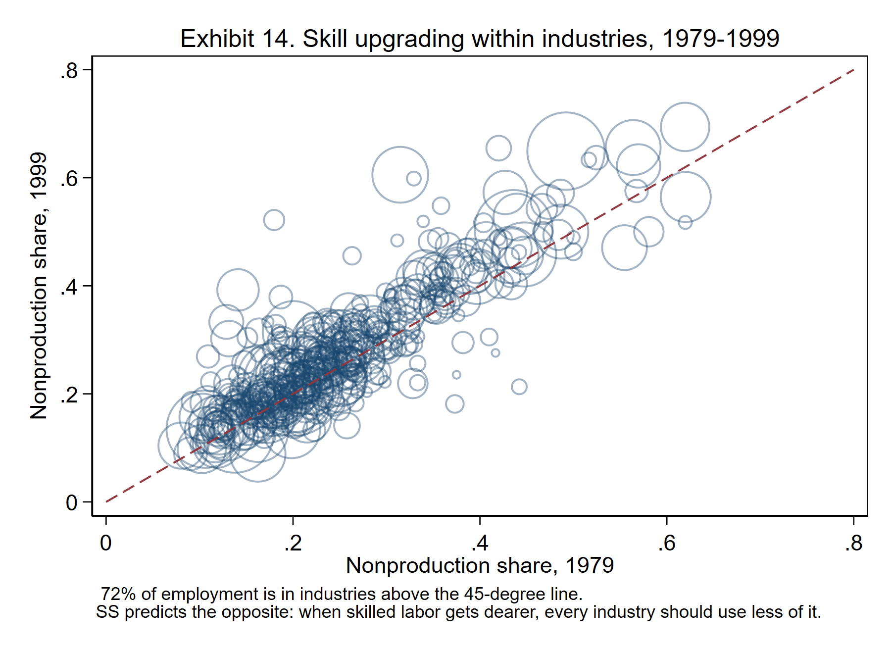

**Result.** **72%** of 1979 manufacturing employment was in industries whose nonproduction share *rose* by 1999.

**Discuss.** This is the most damaging exhibit for a pure SS story. In HO, when skilled labor becomes more expensive, *every* industry substitutes toward unskilled labor; skill upgrading happens only *between* industries, as output shifts toward skill-intensive sectors. Instead, almost every industry upgraded *at the same time* as skilled workers got more expensive. That combination points to skill-biased technical change (Berman, Bound and Griliches 1994).

## Close the log

```stata
log close holab
display "Lab complete. Figures and data are in output/."
```

## Scorecard

| Result | Test | Verdict |
| --- | --- | --- |
| HO theorem | Export mix and net exports vs $K/L$ (Exhibits 5–7) | **Survives.** Strong, every year, though weaker for labor-intensive goods |
| FPE | Wages vs $K/L$ (Exhibits 3–4) | **Fails** in levels; gaps are 15-fold |
| Rybczynski | Change in export mix vs change in $K/L$ (Exhibits 8–9) | **Weak.** Clear in case studies, not in fixed-effects regressions |
| Factor intensity | Sector $K/L$ and rank stability (Exhibits 10–11) | **Survives.** Large, stable differences |
| Stolper-Samuelson | Goods prices vs skill intensity; within-industry upgrading (Exhibits 12–14) | **Not the main story** for the US skill premium |

**Exit question.** Which assumption of the 2×2 model would you drop first to fit these facts: identical technologies, two factors only, free trade, or complete diversification? Each choice leads to a different model we study next (Krugman, Armington).

## References

- Berman, E., J. Bound and Z. Griliches (1994). "Changes in the Demand for Skilled Labor within U.S. Manufacturing." *Quarterly Journal of Economics* 109(2).
- Becker, R., W. Gray and J. Marvakov (2021). NBER-CES Manufacturing Industry Database.
- Feenstra, R., R. Inklaar and M. Timmer (2015). "The Next Generation of the Penn World Table." *American Economic Review* 105(10).
- Gaulier, G. and S. Zignago (2010). "BACI: International Trade Database at the Product-Level." CEPII Working Paper 2010-23.
- Lawrence, R. and M. Slaughter (1993). "International Trade and American Wages in the 1980s: Giant Sucking Sound or Small Hiccup?" *Brookings Papers on Economic Activity: Microeconomics*.
- Leamer, E. (1998). "In Search of Stolper-Samuelson Linkages between International Trade and Lower Wages." In S. Collins (ed.), *Imports, Exports, and the American Worker*. Brookings.
- Trefler, D. (1995). "The Case of the Missing Trade and Other Mysteries." *American Economic Review* 85(5).
