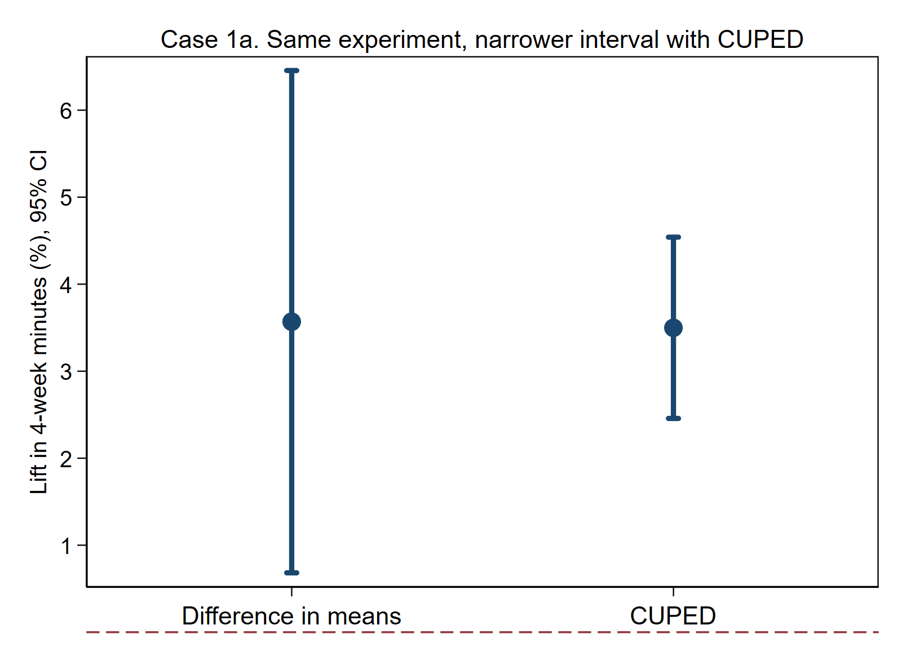
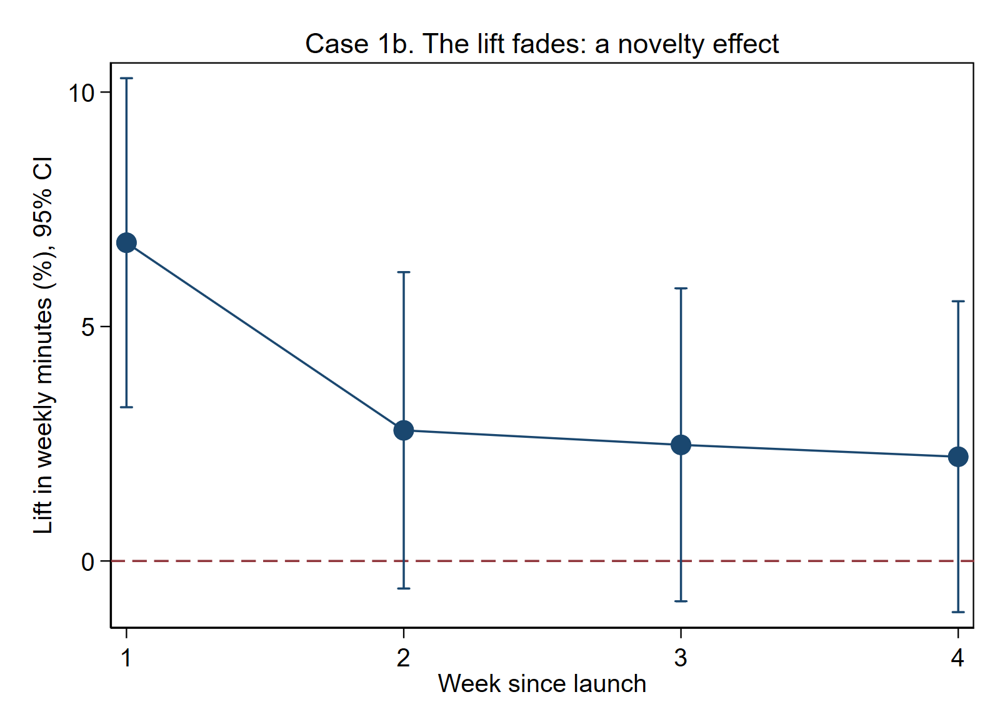
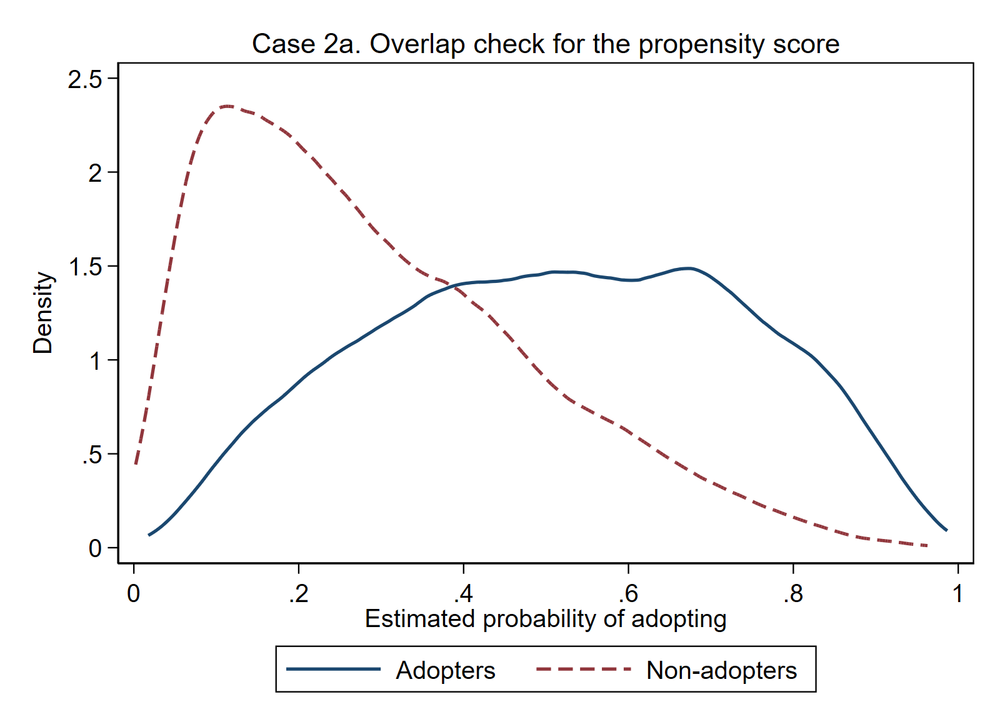
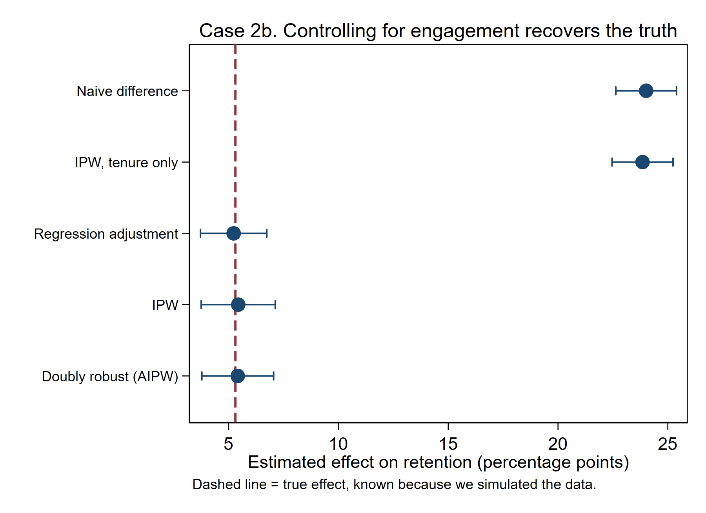
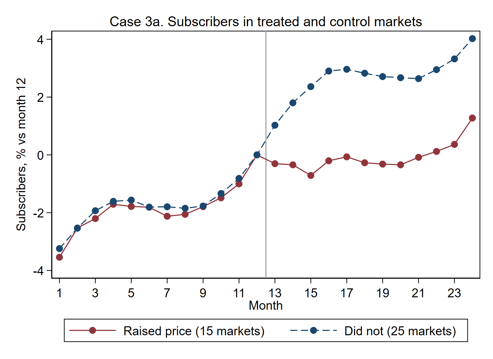
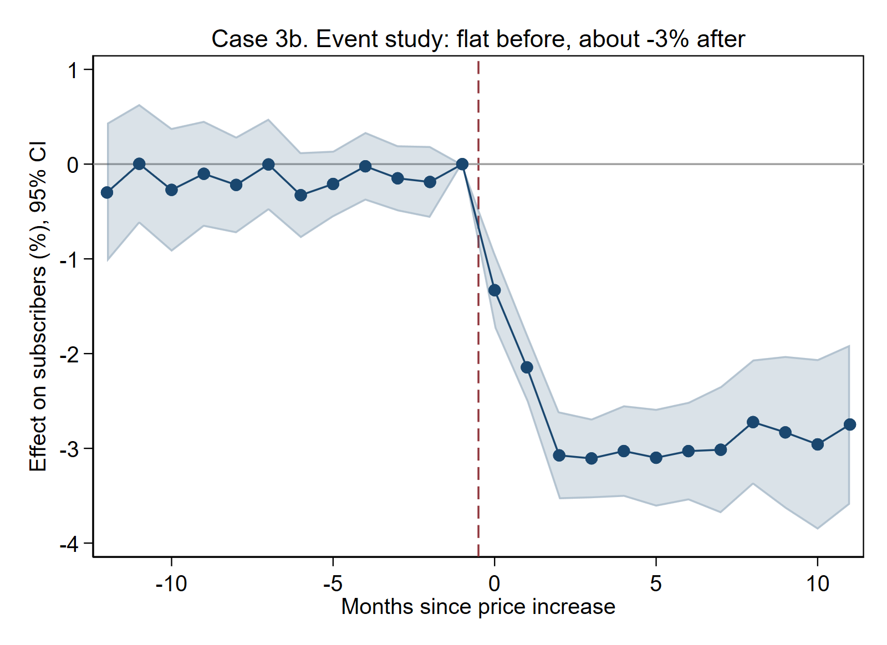
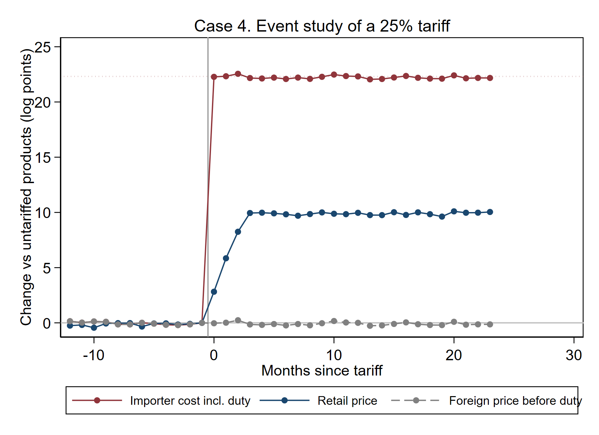
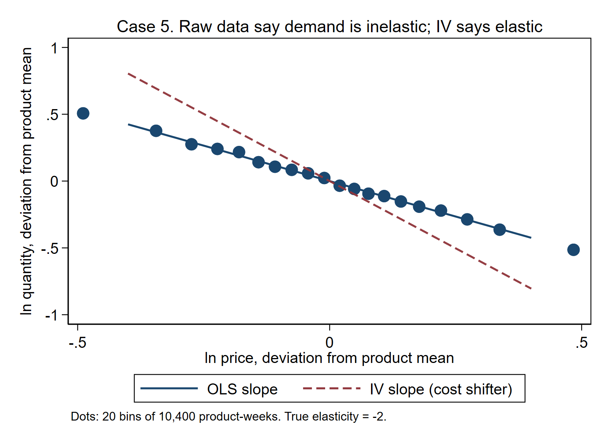

# Empirical case interviews: an answer key in Stata

**ECON 561 · five practice cases for economist and data scientist interviews**

Tech companies (Amazon, Spotify, Uber, Netflix, Microsoft) and consulting firms hire economists to answer business questions with data. Work that used to go to outside consultants is now done in-house. The interview usually includes a **case**: a short business question, sometimes with a dataset, and 30 to 60 minutes to give a recommendation. The interviewer is grading four things:

1. **Do you name the right comparison?** What is the counterfactual, and why would a naive comparison be wrong?
2. **Do you check the data before estimating?** Randomization, balance, pre-trends, outliers.
3. **Do you get the number and its uncertainty right?**
4. **Do you turn the number into a decision?** Ship or not, which price, who pays.

The five cases below are written in that style. **The companies and numbers are illustrative.** These are not actual interview questions from any firm, and every dataset is **simulated**. Because we wrote the simulation, we know the **true answer**, so you can see which methods find it and which do not. That is the best way to learn why the methods matter.

| Case | Business question | Method | Trade link |
| --- | --- | --- | --- |
| 1 | Did a new recommendation feature raise listening? | A/B test, CUPED, novelty, power | |
| 2 | Feature users retain more. Did the feature cause it? | Selection bias, regression adjustment, propensity scores | |
| 3 | We raised the price in 15 markets. What happened? | Difference-in-differences, event study | |
| 4 | Who paid the 25% tariff? | Event study, pass-through | Tariff incidence (Amiti, Redding and Weinstein 2019) |
| 5 | What is our price elasticity, and what price should we set? | Instrumental variables, markup rule | Cost shocks from freight and exchange rates |

**How to use this page.** Read the **prompt** and write down your plan *before* you look at the code. Then run the code block in Stata (open [interview_cases.do](interview_cases.do), or paste the blocks in order), and compare your plan with the **model answer**. No internet or packages needed.

```stata
* ----- 0. Setup -----
version 16.0
clear all
set more off
set scheme s1color
capture mkdir output
capture log close cases
log using "output/interview_cases.log", text replace name(cases)
```

---

## Case 1. A/B test: a new recommendation feature

> **Prompt.** "We launched a new playlist recommendation feature to a random half of 20,000 users for four weeks. The product team says listening went up 3.6%. Should we ship it to everyone? Is 3.6% the right number?"

**A strong answer covers:** (i) check that randomization worked *before* reading the result; (ii) estimate the lift with a confidence interval; (iii) reduce noise with pre-period data (CUPED); (iv) check whether the effect fades (novelty); (v) check who it works for; (vi) say how big the next test must be.

```stata
* ----- Case 1. A/B test: did the new recommendation feature raise listening? -----
* 1a. Simulate the experiment: 20,000 users, 4 weeks after launch
clear
set seed 561
set obs 20000
gen id      = _n
gen treat   = runiform() < .5
gen premium = runiform() < .4
gen pre     = exp(rnormal(5,.8))               // minutes per week BEFORE the test
expand 4
bysort id: gen week = _n
gen eff = (.02 + .04*exp(-(week-1))) * cond(premium,.5,1.5)   // true lift, fading over time
gen y0  = pre*exp(rnormal(0,.5) - .125)        // minutes without the feature
gen y1  = y0*exp(eff)                          // minutes with the feature
gen minutes = cond(treat, y1, y0)
save "output/case1_panel.dta", replace
collapse (sum) minutes y0 y1 (first) treat premium pre, by(id)
quietly summarize y1
local m1 = r(mean)
quietly summarize y0
display "TRUE 4-week lift = " %5.2f 100*(`m1'/r(mean)-1) "%"
```

**What the simulation builds in.** Users' baseline listening varies a lot (a log-normal distribution). The feature raises listening by 6% in week 1, fading to about 2% by week 4, and it works three times as well for free users as for premium users. The true 4-week lift is **4.02%**.

```stata
* 1b. Sanity checks before looking at outcomes
count if treat
bitesti 20000 `r(N)' .5                         // sample ratio mismatch (SRM) test
ttest pre, by(treat)                            // pre-period balance
```

**Answer.** 9,977 of 20,000 users are in treatment. The binomial test of a 50/50 split gives $p=0.63$, so there is no **sample ratio mismatch**. Pre-period minutes are balanced ($p=0.96$). If either check failed, stop: the assignment or the logging is broken, and no estimate can be trusted.

```stata
* 1c. The estimate, then CUPED (use pre-period minutes to cut noise)
regress minutes treat, robust
quietly summarize minutes if treat==0
local ctrl = r(mean)
display "Lift = " %5.2f 100*_b[treat]/`ctrl' "% of control mean"
quietly correlate minutes pre, covariance
local theta = r(cov_12)/r(Var_2)
quietly summarize pre
gen cuped = minutes - `theta'*(pre - r(mean))
regress cuped treat, robust
display "CUPED lift = " %5.2f 100*_b[treat]/`ctrl' "% of control mean"

tempname h
postfile `h' str12 method b lo hi using "output/case1_ci.dta", replace
foreach v in minutes cuped {
    quietly regress `v' treat, robust
    post `h' ("`v'") (100*_b[treat]/`ctrl') (100*(_b[treat]-1.96*_se[treat])/`ctrl') ///
        (100*(_b[treat]+1.96*_se[treat])/`ctrl')
}
postclose `h'
preserve
use "output/case1_ci.dta", clear
gen x = _n
list, noobs
twoway (rcap lo hi x, lcolor(navy) lwidth(thick)) (scatter b x, mcolor(navy) msize(large)), ///
       xlabel(1 "Difference in means" 2 "CUPED", labsize(medium)) xscale(range(.5 2.5)) ///
       yline(0, lcolor(maroon) lpattern(dash)) ylabel(, angle(0)) legend(off) xtitle("") ///
       ytitle("Lift in 4-week minutes (%), 95% CI") ///
       title("Case 1a. Same experiment, narrower interval with CUPED", size(medium))
graph export "output/C1a_cuped.png", width(1600) replace
restore
```



**Answer.** The difference in means is **+29.0 minutes** over four weeks, a **3.57%** lift, with a 95% CI of 0.7% to 6.5%. That is significant, but the interval is wide. **CUPED** subtracts the part of each user's outcome predicted by their own pre-period listening, $Y - \theta(X - \bar X)$ with $\theta = \mathrm{cov}(Y,X)/\mathrm{var}(X)$. Randomization makes $X$ unrelated to treatment, so the estimate stays unbiased, but the noise shrinks. CUPED gives **3.50%**, CI **2.5% to 4.5%**: the standard error falls by 64%, from 12.0 to 4.3 minutes.

```stata
* 1d. Heterogeneity: free vs premium users
regress minutes i.treat##i.premium, robust
```

**Answer.** Free users: **+53 minutes** (about +6.6%, SE 16). Premium users: 53 − 60 = −7 minutes, not distinguishable from zero. The interaction is significant ($p=0.013$). The gain comes from free users. That matters for the business case, because free users are the ones we want to convert.

```stata
* 1e. Novelty: is the effect fading week by week?
preserve
use "output/case1_panel.dta", clear
tempname g
postfile `g' week b lo hi using "output/case1_weeks.dta", replace
forvalues w = 1/4 {
    quietly summarize minutes if treat==0 & week==`w'
    local c = r(mean)
    quietly regress minutes treat if week==`w', robust
    post `g' (`w') (100*_b[treat]/`c') (100*(_b[treat]-1.96*_se[treat])/`c') (100*(_b[treat]+1.96*_se[treat])/`c')
}
postclose `g'
use "output/case1_weeks.dta", clear
list, noobs
twoway (rcap lo hi week, lcolor(navy)) (connected b week, mcolor(navy) lcolor(navy) msize(large)), ///
       yline(0, lcolor(maroon) lpattern(dash)) xlabel(1/4) ylabel(, angle(0)) legend(off) ///
       xtitle("Week since launch") ytitle("Lift in weekly minutes (%), 95% CI") ///
       title("Case 1b. The lift fades: a novelty effect", size(medium))
graph export "output/C1b_novelty.png", width(1600) replace
restore
```



**Answer.** Lift by week: **6.8%, 2.8%, 2.5%, 2.2%**. The first-week jump is a **novelty effect**: people try the new thing. The long-run effect is closer to 2%. Report that number, not 3.6%, as the steady-state gain.

```stata
* 1f. Power: how many users per arm to detect a 2% lift in 4-week minutes?
quietly summarize minutes if treat==0
local m = r(mean)
local s = r(sd)
power twomeans `m' `=1.02*`m'', sd(`s') power(.8)
quietly regress minutes pre if treat==0
power twomeans `m' `=1.02*`m'', sd(`=e(rmse)') power(.8)
```

**Answer.** To detect a 2% lift with 80% power you need **40,734 users per arm** using raw minutes, but only **5,849 per arm** after adjusting for pre-period minutes. That is 86% fewer users, which means faster tests.

**Recommendation.** Ship it, but tell the product team the durable lift is about **2%**, concentrated among free users. Keep a small holdout group for a few more weeks to confirm the decay levels off.

**Follow-ups to expect.** *What if users in treatment and control talk to each other (spillovers)?* *What if the metric is revenue, which is heavy-tailed?* (Winsorize, or use a log or a rank test.) *You checked 10 metrics and one is significant: is that a finding?* (Multiple testing.)

---

## Case 2. Selection bias: does a feature cause retention?

> **Prompt.** "Users who turned on our 'smart shuffle' feature had a 24-point higher 3-month retention rate. Marketing wants to push every user to turn it on. What do you tell them?"

**A strong answer covers:** the users who adopt a feature are different from those who don't. Name the confounder (engagement), say which way it biases the estimate, adjust for what is observed, check overlap, and say what you would do if the confounder is *not* observed.

```stata
* ----- Case 2. Selection: users who adopt a feature retain more. Did the feature cause it? -----
clear
set seed 562
set obs 20000
gen engage = rnormal()                          // engagement drives adoption AND retention
gen tenure = runiform()*36                      // months as a customer
gen adopt  = runiform() < invlogit(-1 + 1.2*engage + .02*tenure)
gen p0 = invlogit(-.3 + .9*engage + .01*tenure)
gen p1 = invlogit(-.3 + .9*engage + .01*tenure + .25)
gen u  = runiform()
gen retained = cond(adopt, u<p1, u<p0)
gen te = 100*(p1 - p0)
summarize te
local truth = r(mean)
display "TRUE average effect on retention = " %4.1f `truth' " percentage points"
```

**What the simulation builds in.** Engaged users are more likely to adopt *and* more likely to stay. The feature itself raises retention by **5.3 percentage points** on average.

```stata
tempname k
postfile `k' str28 method b se using "output/case2_est.dta", replace
quietly regress retained adopt, robust
post `k' ("Naive difference") (100*_b[adopt]) (100*_se[adopt])
quietly teffects ipw (retained) (adopt tenure, logit)
post `k' ("IPW, tenure only") (100*_b[ATE:r1vs0.adopt]) (100*_se[ATE:r1vs0.adopt])
quietly teffects ra (retained engage tenure, logit) (adopt)
post `k' ("Regression adjustment") (100*_b[ATE:r1vs0.adopt]) (100*_se[ATE:r1vs0.adopt])
quietly teffects ipw (retained) (adopt engage tenure, logit)
post `k' ("IPW") (100*_b[ATE:r1vs0.adopt]) (100*_se[ATE:r1vs0.adopt])
quietly teffects aipw (retained engage tenure, logit) (adopt engage tenure, logit)
post `k' ("Doubly robust (AIPW)") (100*_b[ATE:r1vs0.adopt]) (100*_se[ATE:r1vs0.adopt])
postclose `k'
```

**Stata translation.** `teffects ra` fits an outcome model for each group and averages the predicted difference. `teffects ipw` reweights users by the inverse of their probability of adopting, so the two groups look alike. `teffects aipw` does both, and it is right if *either* model is right ("doubly robust").

```stata
* Overlap: do adopters and non-adopters share a common range of propensity scores?
logit adopt engage tenure
predict ps, pr
twoway (kdensity ps if adopt==1, lcolor(navy) lwidth(medthick)) ///
       (kdensity ps if adopt==0, lcolor(maroon) lwidth(medthick) lpattern(dash)), ///
       legend(order(1 "Adopters" 2 "Non-adopters") rows(1)) ylabel(, angle(0)) ///
       xtitle("Estimated probability of adopting") ytitle("Density") ///
       title("Case 2a. Overlap check for the propensity score", size(medium))
graph export "output/C2a_overlap.png", width(1600) replace
```



**Answer.** Adopters and non-adopters overlap across most of the range, so reweighting is feasible. If they did not overlap, no method could compare them.

```stata
use "output/case2_est.dta", clear
gen lo = b - 1.96*se
gen hi = b + 1.96*se
gen y  = _N - _n + 1
list method b se, noobs
forvalues i = 1/`=_N' {
    local lbl `lbl' `=y[`i']' "`=method[`i']'"
}
twoway (rcap lo hi y, horizontal lcolor(navy)) (scatter y b, mcolor(navy) msize(large)), ///
       xline(`truth', lcolor(maroon) lwidth(medthick) lpattern(dash)) ///
       ylabel(`lbl', angle(0) labsize(small)) yscale(range(.5 5.5)) legend(off) ytitle("") ///
       xtitle("Estimated effect on retention (percentage points)") ///
       title("Case 2b. Controlling for engagement recovers the truth", size(medium)) ///
       note("Dashed line = true effect, known because we simulated the data.")
graph export "output/C2b_estimates.png", width(1800) replace
```



| Method | Estimate (pp) | SE |
| --- | ---: | ---: |
| Naive difference | 24.0 | 0.7 |
| IPW, tenure only | 23.8 | 0.7 |
| Regression adjustment | 5.2 | 0.8 |
| IPW (engagement + tenure) | 5.4 | 0.9 |
| Doubly robust (AIPW) | 5.4 | 0.8 |
| **Truth** | **5.3** | |

**Answer.** The naive 24 points is mostly selection: about 19 of the 24 points would show up even if the feature did nothing. Adjusting for engagement recovers the truth. **But look at the second row.** Adjusting for the wrong variables, here tenure alone, is no better than doing nothing. Every method in rows 3 to 5 works *only because* we observe engagement. In real data you never know whether you have measured every confounder.

**Recommendation.** Tell marketing the causal effect is about **5 points, not 24**. Before a campaign, run an **encouragement design**: randomly prompt half of users to try the feature. The random prompt is a valid instrument for adoption, and it answers exactly their question: what happens if we push people to turn it on?

---

## Case 3. Difference-in-differences: a price increase

> **Prompt.** "In month 13 we raised the monthly price from $10.99 to $11.99 in 15 of our 40 markets. Subscribers in those markets fell. Was the price increase a mistake?"

**A strong answer covers:** comparing treated markets before and after mixes the price effect with everything else that changed. Use the untreated markets as the counterfactual trend, check **parallel pre-trends**, estimate the effect on subscribers *and* revenue, and turn it into an elasticity.

```stata
* ----- Case 3. Difference-in-differences: a price increase in 15 of 40 markets -----
clear
set seed 563
set obs 40
gen market = _n
gen treat  = market <= 15                       // markets that raised the price
gen a      = rnormal(13,1)                      // market size (ln subscribers)
gen g      = rnormal(.004,.001)                 // market-specific growth rate
expand 24
bysort market: gen month = _n
gen post = month >= 13
gen e    = month - 13                           // event time; price rises at e = 0
gen true_eff = 0
replace true_eff = -.010 if treat & e==0
replace true_eff = -.020 if treat & e==1
replace true_eff = -.030 if treat & e>=2
gen price  = 10.99 + treat*post*1.00
gen lnsubs = a + g*month + .01*sin(month/2) + true_eff + rnormal(0,.004)
gen lnrev  = ln(price) + lnsubs
xtset market month
```

```stata
* 3a. Raw trends, normalized to the month before the change
bysort market (month): gen base = lnsubs[12]
gen idx = 100*(lnsubs - base)
preserve
collapse (mean) idx, by(treat month)
twoway (connected idx month if treat==1, lcolor(maroon) mcolor(maroon)) ///
       (connected idx month if treat==0, lcolor(navy) mcolor(navy) lpattern(dash)), ///
       xline(12.5, lcolor(gs10)) ylabel(, angle(0)) xlabel(1(2)24) ///
       legend(order(1 "Raised price (15 markets)" 2 "Did not (25 markets)") rows(1)) ///
       xtitle("Month") ytitle("Subscribers, % vs month 12") ///
       title("Case 3a. Subscribers in treated and control markets", size(medium))
graph export "output/C3a_trends.png", width(1600) replace
restore
```



```stata
* 3b. DiD regression with market and month fixed effects
gen D = treat*post
xtreg lnsubs D i.month, fe vce(cluster market)
local dsubs = _b[D]
xtreg lnrev  D i.month, fe vce(cluster market)
display "Implied elasticity of subscribers to price = " %5.2f `dsubs'/ln(11.99/10.99)
```

**Answer.** With market and month fixed effects and SEs clustered by market, subscribers fell **2.6%** (SE 0.4) relative to control markets, while **revenue rose 6.1%** (SE 0.4). The price rose 8.7 log points, so the subscriber elasticity is about **−0.30**: demand is inelastic, and that is why revenue went up.

```stata
* 3c. Event study: one coefficient per month relative to month 12 (e = -1)
gen ev = cond(treat, e + 12, 11)                // 0..23; base 11 = month before
xtreg lnsubs ib11.ev i.month, fe vce(cluster market)
tempname q
postfile `q' e b lo hi using "output/case3_es.dta", replace
forvalues k = 0/23 {
    if `k'==11 post `q' (-1) (0) (0) (0)
    else post `q' (`k'-12) (100*_b[`k'.ev]) (100*(_b[`k'.ev]-1.96*_se[`k'.ev])) (100*(_b[`k'.ev]+1.96*_se[`k'.ev]))
}
postclose `q'
preserve
use "output/case3_es.dta", clear
twoway (rarea lo hi e, color(navy%20)) (connected b e, lcolor(navy) mcolor(navy)), ///
       yline(0, lcolor(gs10)) xline(-.5, lcolor(maroon) lpattern(dash)) ylabel(, angle(0)) ///
       legend(off) xtitle("Months since price increase") ytitle("Effect on subscribers (%), 95% CI") ///
       title("Case 3b. Event study: flat before, about -3% after", size(medium))
graph export "output/C3b_event_study.png", width(1600) replace
restore
```



**Answer.** The 11 pre-period coefficients (months −12 to −2; month −1 is the base) are all near zero and inside the confidence band: no sign that treated markets were already diverging. Subscribers fall over 2 months, then level off at about **−3%**. The DiD average (−2.6%) is slightly smaller because it includes the ramp-up months.

**Recommendation.** It was not a mistake: revenue rose about 6%. Two caveats for the interviewer. (1) Twelve months may miss slow churn, so keep tracking it. (2) Why were *these* 15 markets chosen? If they were picked because demand was strong, the control markets are not a fair comparison. Ask how the markets were chosen before you trust the estimate.

**Follow-ups to expect.** *What if markets raised prices at different dates?* (Staggered adoption: plain two-way fixed effects can be badly biased. Use an estimator built for it, such as Callaway and Sant'Anna 2021.) *How would you pick which market to raise next?* (Look at heterogeneity by income or local competition.)

---

## Case 4. Tariff pass-through: who paid the tariff?

> **Prompt.** "In month 13 a 25% tariff was imposed on 400 of the 1,000 products we import. Our CFO says foreign suppliers will absorb it. How much did prices go up, for us and for our customers?"

This is the question trade economists asked about the 2018–2019 US tariffs on China. Amiti, Redding and Weinstein (2019) and Fajgelbaum et al. (2020) found **close to complete pass-through** into US import prices: foreign exporters did not cut their prices, so US importers paid the tariff. Cavallo et al. (2021) found that **retail** prices rose much less: retailers absorbed part of the tariff in their margins.

```stata
* ----- Case 4. Tariff pass-through: who paid the 25% tariff? -----
clear
set seed 564
set obs 1000
gen product = _n
gen tariffed = product <= 400                   // 400 products hit by a 25% tariff in month 13
gen a = rnormal(3,1)
expand 36
bysort product: gen month = _n
gen e = month - 13
gen ramp = 0
replace ramp = .3  if tariffed & e==0
replace ramp = .6  if tariffed & e==1
replace ramp = .85 if tariffed & e==2
replace ramp = 1   if tariffed & e>=3
gen lnp_border = a + .001*month + rnormal(0,.02)            // price before duty: unchanged
gen lnp_duty   = lnp_border + ln(1.25)*(tariffed & e>=0)    // importer's cost incl. duty
gen lnp_retail = a + .3 + .002*month + .45*ln(1.25)*ramp + rnormal(0,.02)  // shelf price
xtset product month
gen ev = cond(tariffed, e + 12, 11)
```

**What the simulation builds in.** The foreign price does not move. The importer's cost including duty jumps by $\ln(1.25)=22.3$ log points. Retail prices pass through **45%** of the tariff, phased in over three months.

```stata
tempname r
postfile `r' str12 outcome e b lo hi using "output/case4_es.dta", replace
foreach y in lnp_border lnp_duty lnp_retail {
    quietly xtreg `y' ib11.ev i.month, fe vce(cluster product)
    forvalues k = 0/35 {
        if `k'==11 post `r' ("`y'") (-1) (0) (0) (0)
        else post `r' ("`y'") (`k'-12) (100*_b[`k'.ev]) (100*(_b[`k'.ev]-1.96*_se[`k'.ev])) (100*(_b[`k'.ev]+1.96*_se[`k'.ev]))
    }
}
postclose `r'
```

```stata
* Pass-through = price change / tariff change, using months 3+ after the tariff
gen D = tariffed & e>=3
gen ramp_up = tariffed & inrange(e,0,2)
foreach y in lnp_border lnp_duty lnp_retail {
    quietly xtreg `y' D ramp_up i.month, fe vce(cluster product)
    display "`y': pass-through = " %4.2f _b[D]/ln(1.25) "  (SE " %4.2f _se[D]/ln(1.25) ")"
}

preserve
use "output/case4_es.dta", clear
twoway (connected b e if outcome=="lnp_duty",   lcolor(maroon) mcolor(maroon) msize(small)) ///
       (connected b e if outcome=="lnp_retail", lcolor(navy) mcolor(navy) msize(small)) ///
       (connected b e if outcome=="lnp_border", lcolor(gs8) mcolor(gs8) msize(small) lpattern(dash)), ///
       yline(0, lcolor(gs12)) yline(`=100*ln(1.25)', lcolor(maroon%40) lpattern(dot)) ///
       xline(-.5, lcolor(gs10)) ylabel(, angle(0)) ///
       legend(order(1 "Importer cost incl. duty" 2 "Retail price" 3 "Foreign price before duty") rows(1) size(small)) ///
       xtitle("Months since tariff") ytitle("Change vs untariffed products (log points)") ///
       title("Case 4. Event study of a 25% tariff", size(medium))
graph export "output/C4_passthrough.png", width(1800) replace
restore
```



**Answer.** Pass-through, measured as the price change divided by the change in $\ln(1+\tau)$:

| Price | Pass-through | Who bears it |
| --- | ---: | --- |
| Foreign price before duty | 0.00 | Foreign exporters absorbed nothing |
| Importer cost including duty | 1.00 | We paid the full tariff |
| Retail price | 0.45 | Customers paid 45%; our margin absorbed 55% |

**Recommendation.** The CFO is wrong: suppliers absorbed none of it. Customers pay less than half through higher shelf prices; the rest comes out of our margin. Next steps: look at where pass-through is lower (products with close untariffed substitutes) and check whether we can switch suppliers to untariffed countries. That is trade diversion, which Fajgelbaum et al. document.

---

## Case 5. Price elasticity: why OLS gives a dangerous answer

> **Prompt.** "We have two years of weekly prices and sales for 200 products. Estimate the price elasticity and tell us whether to raise prices."

**A strong answer covers:** prices are not random. We raise prices when demand is strong (holidays, trends), so price is correlated with the demand shock. That **simultaneity** biases OLS toward zero, which makes demand look less elastic than it is. You need a variable that shifts **price but not demand**: a cost shock such as freight rates, exchange rates or tariffs.

```stata
* ----- Case 5. Price elasticity: OLS vs instrumental variables -----
clear
set seed 565
set obs 200
gen product = _n
gen a = rnormal(8,1)
gen c = rnormal(2,.5)
expand 52
bysort product: gen week = _n
gen xi  = rnormal(0,.3)                          // demand shock the retailer sees, we don't
gen z   = rnormal(0,.15)                         // cost shock: freight and exchange rate
gen lnmc = c + z
gen lnp  = lnmc + ln(2) + .6*xi + rnormal(0,.05) // price rises when demand is high
gen lnq  = a - 2*lnp + xi + rnormal(0,.1)        // TRUE elasticity = -2
xtset product week

xtreg lnq lnp, fe vce(cluster product)
local b_ols = _b[lnp]
xtreg lnp z, fe vce(cluster product)                 // first stage
test z
xtivreg lnq (lnp = z), fe vce(cluster product)
local b_iv = _b[lnp]
display "OLS elasticity = " %5.2f `b_ols' "   IV elasticity = " %5.2f `b_iv'
display "Optimal markup p/mc = e/(e+1):  IV -> " %4.2f `b_iv'/(`b_iv'+1) ///
        "   OLS -> " cond(`b_ols' > -1, "none (demand looks inelastic: raise price forever)", string(`b_ols'/(`b_ols'+1),"%4.2f"))
```

**Answer.**

| | Elasticity | SE |
| --- | ---: | ---: |
| OLS with product fixed effects | −1.06 | 0.01 |
| IV, cost shifter as instrument | **−2.01** | 0.02 |
| Truth | −2.00 | |

The first stage is very strong ($F = 6{,}735$). OLS is precise *and wrong*. A tiny standard error does not mean the estimate is unbiased.

**Why it matters for the decision.** With constant elasticity $\varepsilon$, the profit-maximizing price is $p = \frac{\varepsilon}{1+\varepsilon}\,mc$, the Lerner rule. With the IV elasticity, $p/mc = -2.01/(-1.01) = 1.99$: price at about twice marginal cost. With the OLS elasticity, $p/mc = -1.06/(-0.06) \approx 17$. Following OLS, you would raise prices about ninefold and lose most of your customers.

```stata
* Picture: within-product variation, 20 bins
bysort product: egen mp = mean(lnp)
bysort product: egen mq = mean(lnq)
gen dp = lnp - mp
gen dq = lnq - mq
xtile bin = dp, nq(20)
preserve
collapse (mean) dp dq, by(bin)
twoway (scatter dq dp, mcolor(navy) msize(large)) ///
       (function y = `b_ols'*x, range(-.4 .4) lcolor(navy) lwidth(medthick)) ///
       (function y = `b_iv'*x,  range(-.4 .4) lcolor(maroon) lwidth(medthick) lpattern(dash)), ///
       ylabel(, angle(0)) legend(order(2 "OLS slope" 3 "IV slope (cost shifter)") rows(1)) ///
       xtitle("ln price, deviation from product mean") ytitle("ln quantity, deviation from product mean") ///
       title("Case 5. Raw data say demand is inelastic; IV says elastic", size(medium)) ///
       note("Dots: 20 bins of 10,400 product-weeks. True elasticity = -2.")
graph export "output/C5_elasticity.png", width(1600) replace
restore
```



**Recommendation.** Use the IV elasticity, about −2. Current prices are close to optimal, so do not raise them across the board. **The instrument must satisfy the exclusion restriction:** freight and exchange-rate shocks must affect sales *only* through price. That is an argument you have to make, not something the data can show. If no good instrument exists, propose a **randomized price test** on a small share of traffic.

---

## Close the log

```stata
log close cases
display "All five cases done. Figures and logs are in output/."
```

## Cheat sheet: which tool for which question

| You hear... | Ask yourself | Tool |
| --- | --- | --- |
| "We ran a test" | Did randomization work? Is the effect durable? | SRM check, balance, CUPED, effect by week |
| "Users who did X do better" | Who chooses X? | Regression adjustment, IPW, encouragement design |
| "We changed something in some places" | What would have happened anyway? | DiD, event study, pre-trends |
| "A cost went up" | Who bears it? | Event study, pass-through ratio |
| "What should our price be?" | Is price correlated with demand shocks? | IV with cost shifters, Lerner rule |

## References

- Amiti, M., S. Redding and D. Weinstein (2019). "The Impact of the 2018 Tariffs on Prices and Welfare." *Journal of Economic Perspectives* 33(4).
- Callaway, B. and P. Sant'Anna (2021). "Difference-in-Differences with Multiple Time Periods." *Journal of Econometrics* 225(2).
- Cavallo, A., G. Gopinath, B. Neiman and J. Tang (2021). "Tariff Pass-Through at the Border and at the Store." *American Economic Review: Insights* 3(1).
- Deng, A., Y. Xu, R. Kohavi and T. Walker (2013). "Improving the Sensitivity of Online Controlled Experiments by Utilizing Pre-Experiment Data." *WSDM* (the CUPED paper).
- Fajgelbaum, P., P. Goldberg, P. Kennedy and A. Khandelwal (2020). "The Return to Protectionism." *Quarterly Journal of Economics* 135(1).
