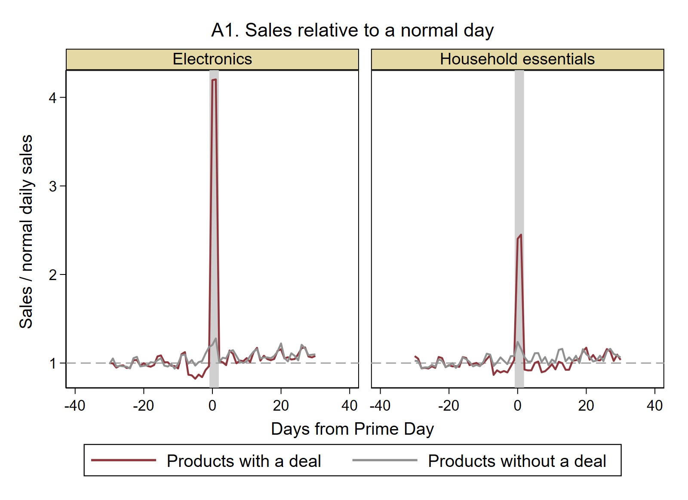
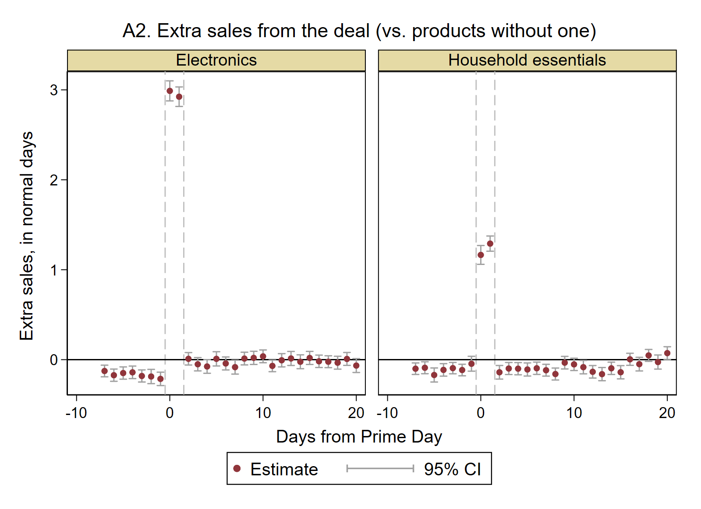
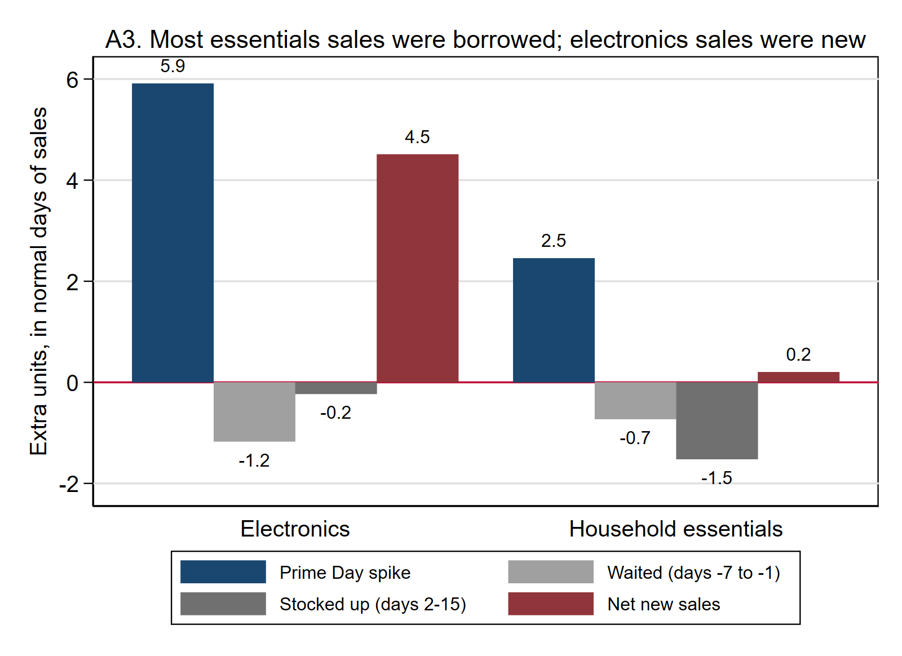
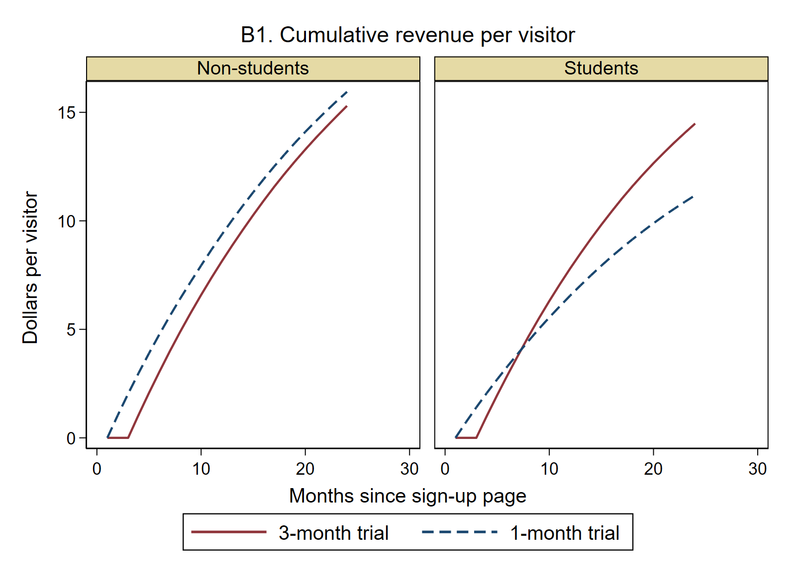

# Mock data-science interviews: two business cases in Stata

**ECON 561 · from coding and statistics to a recommendation your manager can act on**

In class I keep coming back to Amazon and Spotify. Firms like these hire economists and data scientists to answer business questions with data, and their interviews test exactly that: you get a question and a dataset, and you have about 45 minutes to give a recommendation. This page walks through two cases in that style, from the first question you should ask to the slide you would show your manager.

**The firms are illustrative and the data are simulated.** These are not actual interview questions from Amazon or Spotify. Because we simulated the data, we know the true answer, so you can see that the method finds it.

Every case follows the same five steps. Interviewers grade the steps, not just the final number:

| Step | What you do | What the interviewer is checking |
| --- | --- | --- |
| 1. Ask | Clarify the goal, the metric, and the comparison | Do you know what question you are answering? |
| 2. Look | Check the data and plot it before estimating | Do you catch problems before they bite? |
| 3. Estimate | Pick the method that matches the comparison | Is the number right, with its uncertainty? |
| 4. Decide | Turn the estimate into dollars and a choice | Can a manager act on it? |
| 5. Present | One headline, one chart, three bullets, caveats | Can you communicate it in two minutes? |

**How to use this page.** Open [mock_interviews.do](mock_interviews.do) in Stata, or paste the code blocks below in order. The data load straight from the web, so you need no packages and no downloads. Before you run each block, read the prompt and write down what *you* would ask and do.

```stata
* ----- 0. Setup -----
version 16.0
clear all
set more off
set scheme s1color
capture mkdir output
capture log close mock
log using "output/mock_interviews.log", text replace name(mock)
global data "https://raw.githubusercontent.com/yang-liang/econ-coding-lab/main/data"
* If you downloaded the two csv files into this folder, use instead:  global data "."
```

---

## Case A (Amazon-style). Was Prime Day worth it?

> **Prompt.** "We ran Prime Day deals (20% off) on about half of our products in two categories, household essentials and electronics. Sales of deal products were up 239% on Prime Day. Marketing wants to double the number of deals next year. What do you recommend?"

### Step 1. Ask before you touch the data

Good questions to ask the interviewer, and why each one matters:

- **"Up 239% compared with what?"** Prime Day brings traffic to the whole site, so products without a deal also sell more that day. The right comparison is deal products against similar products *without* a deal.
- **"Did customers just shift their purchases?"** People hold off buying in the week before a deal they know is coming, and people who stock up buy less afterward. Sales borrowed from other days are not new sales.
- **"How were deal products chosen?"** If the most popular products got deals, deal products sell more on every day. So we compare each product with *its own* normal sales.
- **"Is the goal revenue or profit?"** A 20% discount on a product with a 40% margin cuts the margin per unit in half.

### Step 2. Look at the data

```stata
* ----- Case A. Prime Day: load and look -----
import delimited "$data/primeday.csv", clear varnames(1)
describe
tab category deal
* One row = one product on one day. day 0 and day 1 are Prime Day.
* deal = 1 if the product got a Prime Day discount (20% off list price).
```

The data have 400 products observed for 61 days, from 30 days before Prime Day to 30 days after. Prime Day is days 0 and 1.

First, reproduce the number marketing reports:

```stata
* ----- A1. The number the marketing team reports -----
summarize units if deal & day <= -8, meanonly
local normal = r(mean)
summarize units if deal & inlist(day, 0, 1), meanonly
local prime = r(mean)
display "Deal products: " %4.1f `normal' " units/day normally, " %4.1f `prime' ///
        " on Prime Day.  Naive lift = " %3.0f 100*(`prime'/`normal' - 1) "%"
```

Deal products sell **31.2 units a day normally and 105.9 on Prime Day, +239%**. Now plot every day, not just Prime Day. We divide each product's sales by its own normal daily sales, so 1 means a normal day:

```stata
* ----- A2. Look before you estimate: sales relative to normal, by day -----
* Index every product to its own normal level (days -30 to -8), so big and
* small products count equally: index = 1 means a normal day.
bysort product: egen normal_units = mean(cond(day <= -8, units, .))
gen idx_units  = units / normal_units
gen profit     = units * (price - unit_cost)
gen idx_profit = profit / (normal_units * (list_price - unit_cost))
preserve
collapse (mean) idx_units, by(category deal day)
twoway (line idx_units day if deal == 1, lcolor(maroon) lwidth(medthick)) ///
       (line idx_units day if deal == 0, lcolor(gs9) lwidth(medthick)), ///
       by(category, note("") title("A1. Sales relative to a normal day", size(medium)) rows(1)) ///
       xline(0 1, lcolor(gs13) lwidth(vthick)) yline(1, lpattern(dash) lcolor(gs10)) ///
       xtitle("Days from Prime Day") ytitle("Sales / normal daily sales") ylabel(, angle(0)) ///
       legend(order(1 "Products with a deal" 2 "Products without a deal") rows(1))
graph export "output/A1_sales_index.png", width(1600) replace
restore
```



The picture already tells most of the story. Products *without* a deal (gray) also rise on Prime Day: that is the traffic effect, which the deal did not cause. In the week before, deal products sell *less* than normal. After Prime Day, household essentials stay below normal for about two weeks, but electronics return to normal.

### Step 3. Estimate: an event study

We compare deal products with no-deal products on every day, relative to normal days. This is a difference-in-differences, day by day (an **event study**):

$$\text{index}_{it} = \alpha + \beta\,\text{deal}_i + \sum_{k} \gamma_k\, \mathbf{1}[\text{day}=k] + \sum_{k} \delta_k\,\text{deal}_i \times \mathbf{1}[\text{day}=k] + \varepsilon_{it}$$

Each $\delta_k$ is the extra sales caused by the deal on day $k$, measured in normal days of sales. Standard errors are clustered by product.

```stata
* ----- A3. Event study: the deal effect day by day -----
* Products without a deal are the comparison group: they show what Prime Day
* traffic alone does. Compare each day with normal days (ev = 0).
* The coefficient on deal x day is the extra sales from the deal, measured in
* "normal days of sales".
gen ev = cond(day <= -8, 0, day + 8)           // ev 1..38 = days -7..30
capture postclose es
postfile es str20 category str7 outcome day b lo hi using "output/A_event_study.dta", replace
foreach c in "Household essentials" "Electronics" {
    foreach y in units profit {
        quietly regress idx_`y' i.deal##i.ev if category == "`c'", vce(cluster product)
        forvalues k = 1/38 {
            post es ("`c'") ("`y'") (`k' - 8) (_b[1.deal#`k'.ev]) ///
                 (_b[1.deal#`k'.ev] - 1.96*_se[1.deal#`k'.ev]) (_b[1.deal#`k'.ev] + 1.96*_se[1.deal#`k'.ev])
        }
    }
}
postclose es
preserve
use "output/A_event_study.dta", clear
keep if outcome == "units" & day <= 20
twoway (rcap lo hi day, lcolor(gs10)) (scatter b day, mcolor(maroon) msize(small)), ///
       by(category, note("") title("A2. Extra sales from the deal (vs. products without one)", size(medium)) rows(1)) ///
       yline(0, lcolor(black)) xline(-0.5 1.5, lpattern(dash) lcolor(gs12)) ///
       xtitle("Days from Prime Day") ytitle("Extra sales, in normal days") ylabel(, angle(0)) ///
       legend(order(2 "Estimate" 1 "95% CI") rows(1))
graph export "output/A2_event_study.png", width(1600) replace
restore
```



On Prime Day, a deal adds about 3 normal days of sales per day for electronics, but only about 1.2 for essentials. The dip before Prime Day is visible in both categories. The hangover afterward is only in essentials: people stocked up on detergent, not on headphones.

### Step 4. Decide: add up the windows, in units and in profit

The question is not "how big is the spike" but "how much did the deal add in total." So we add the daily effects over three windows. We do it twice: once for units and once for profit, where profit uses the discounted price on Prime Day.

```stata
* ----- A4. Add it up: how much is new demand, and does it make money? -----
* Sum the daily effects over three windows:
*   spike     = days 0-1 (Prime Day itself)
*   before    = days -7 to -1 (customers wait for the deal)
*   after     = days 2 to 15 (customers stocked up)
local spike  "1.deal#8.ev + 1.deal#9.ev"
local before "1.deal#1.ev"
forvalues k = 2/7 {
    local before "`before' + 1.deal#`k'.ev"
}
local after "1.deal#10.ev"
forvalues k = 11/23 {
    local after "`after' + 1.deal#`k'.ev"
}
capture postclose sums
postfile sums str20 category str7 outcome str7 window b se using "output/A_sums.dta", replace
foreach c in "Household essentials" "Electronics" {
    foreach y in units profit {
        quietly regress idx_`y' i.deal##i.ev if category == "`c'", vce(cluster product)
        foreach w in spike before after {
            quietly lincom ``w''
            post sums ("`c'") ("`y'") ("`w'") (r(estimate)) (r(se))
        }
        quietly lincom `spike' + `before' + `after'
        post sums ("`c'") ("`y'") ("net") (r(estimate)) (r(se))
    }
}
postclose sums
preserve
use "output/A_sums.dta", clear
format b se %6.2f
list category outcome window b se, sepby(category outcome) noobs
restore
```

Effect of a deal per product, in **normal days of sales** (units) or **normal days of profit** (profit); standard errors in parentheses:

| | Prime Day spike | Waited (days −7 to −1) | Stocked up (days 2–15) | **Net** |
| --- | ---: | ---: | ---: | ---: |
| Essentials, units | 2.46 (0.07) | −0.73 (0.11) | −1.52 (0.19) | **0.20 (0.28)** |
| Essentials, profit | 0.03 (0.05) | −0.73 (0.11) | −1.52 (0.19) | **−2.22 (0.27)** |
| Electronics, units | 5.91 (0.09) | −1.17 (0.10) | −0.23 (0.19) | **4.51 (0.28)** |
| Electronics, profit | 1.71 (0.06) | −1.17 (0.10) | −0.23 (0.19) | **0.31 (0.27)** |

How to read it: for essentials, the deal moved sales around instead of creating them. Net new sales are about zero, and because the spike was sold at half the usual margin, each deal **lost about two normal days of profit**. For electronics, about three quarters of the spike is new demand (4.5 of 5.9), and the deal roughly breaks even on profit.

```stata
* ----- A5. The chart for your manager -----
preserve
use "output/A_sums.dta", clear
keep if outcome == "units"
gen order = 1*(window=="spike") + 2*(window=="before") + 3*(window=="after") + 4*(window=="net")
label define w 1 "Prime Day spike" 2 "Waited (days -7 to -1)" 3 "Stocked up (days 2-15)" 4 "Net new sales"
label values order w
graph bar b, over(order, label(labsize(small))) over(category) asyvars ///
       bar(1, color(navy)) bar(2, color(gs10)) bar(3, color(gs7)) bar(4, color(maroon)) ///
       blabel(bar, format(%4.1f) size(small)) yline(0) ///
       ytitle("Extra units, in normal days of sales") ylabel(, angle(0)) ///
       title("A3. Most essentials sales were borrowed; electronics sales were new", size(medium)) ///
       legend(rows(2) size(small))
graph export "output/A3_manager_chart.png", width(1600) replace
restore
```



### Step 5. Present: the slide for your manager

> **Headline: Prime Day deals create new sales in electronics, but in household essentials they mostly borrow sales from the weeks around Prime Day, and they lose money.**
>
> *(Chart A3)*
>
> - The 239% "lift" counts the site-wide traffic boost and ignores the dip before and after. Compared with similar products without a deal, the real gain is much smaller.
> - Electronics: about 75% of the Prime Day spike is new sales; profit roughly breaks even.
> - Household essentials: net new sales are about zero (customers stock up), and each deal costs about two normal days of profit.
>
> **Recommendation:** Don't double deals across the board. Shift them toward electronics and other goods people don't stockpile, and cut deals on essentials unless they bring in new Prime members.
>
> **Caveats:** (1) Deal products were not chosen at random; the flat pre-period in Chart A2 supports the comparison, but a randomized holdout of deals next year would settle it. (2) If deal products steal sales from similar no-deal products, our comparison group is pushed down and we overstate the gain. (3) We do not count long-run value, such as new Prime sign-ups.

---

## Case B (Spotify-style). Should we switch to a 3-month free trial?

> **Prompt.** "We ran an A/B test: half of the visitors to our sign-up page were offered a 3-month free trial instead of the usual 1 month. The growth team says the 3-month trial brought in 38% more trial starts. But the finance team says conversion fell from 50% to 42%. Who is right, and should we switch?"

### Step 1. Ask before you touch the data

- **"Was the split really random, and did it stay 50/50?"** Always check the sample ratio and balance before reading any result.
- **"Conversion out of whom?"** Conversion among trial starters compares two *different* groups of people, because the offer itself changed who starts a trial. The clean comparison is all randomized visitors (**intent to treat**).
- **"What is the goal metric, and over what horizon?"** Trial starts are free; revenue is what matters. A longer trial delays the first payment by two months, so the answer may change with the horizon.
- **"Is the effect the same for everyone?"** Students pay a lower price ($6 vs $11) and may respond differently to a longer trial.

### Step 2. Look: check the experiment, then the funnel

```stata
* ----- Case B. Free-trial test: load and check the experiment -----
import delimited "$data/free_trial_test.csv", clear varnames(1)
describe
* One row = one visitor to the sign-up page, randomly shown a 1-month or a
* 3-month free trial. first_paid_month / last_paid_month are missing if the
* visitor never paid. Price is $6/month for students and $11 for everyone else.
gen three = arm == "3-month"
* Sample ratio check: a 50/50 split should give about 20,000 per arm
tab arm
quietly count if three
display "Sample ratio test p-value = " %5.3f 2*binomial(_N, min(r(N), _N - r(N)), .5)
* Balance: the share of students should be the same in both arms
tab student arm, col chi2
```

The split is 50/50 (sample ratio test p = 0.996), and the share of students is balanced across arms (p = 0.21). The experiment looks clean.

```stata
* ----- B1. The funnel: the metric that misleads -----
gen paid = first_paid_month < .
tabstat trial paid, by(arm) format(%5.3f) nototal
* Conversion among visitors who started a trial (the dashboard number):
tabstat paid if trial, by(arm) format(%5.3f) nototal
* The 3-month arm converts a smaller share of trial starters, but it brings in
* more starters. Who starts a trial is affected by the treatment, so compare
* ALL randomized visitors (intent to treat), never only the starters.
```

| | 1-month trial | 3-month trial |
| --- | ---: | ---: |
| Started a trial (share of visitors) | 20.3% | 28.1% |
| Ever paid (share of visitors) | 10.2% | 11.8% |
| Paid, among trial starters | 50.0% | 41.9% |

Both teams are quoting real numbers. Finance's number is the trap: the 3-month offer pulled in extra, less committed people who start a trial, so the share of starters who pay falls even though *more visitors end up paying* (11.8% vs 10.2%). Never compare outcomes within a group that the treatment itself changed. This is the same selection problem as in the [interview cases lab](../interview-cases/README.md), Case 2.

### Step 3. Estimate: revenue per visitor over time

Paying more often is not the same as paying more: a 3-month trial gives away two extra months. So we track cumulative revenue per randomized visitor, month by month, separately for students and non-students:

```stata
* ----- B2. Revenue per visitor, month by month -----
forvalues m = 1/24 {
    gen rev`m' = price * max(0, min(last_paid_month, `m') - first_paid_month + 1)
    replace rev`m' = 0 if missing(first_paid_month)
}
preserve
collapse (mean) rev1-rev24, by(arm student)
reshape long rev, i(arm student) j(month)
label define st 0 "Non-students" 1 "Students"
label values student st
twoway (line rev month if arm == "3-month", lcolor(maroon) lwidth(medthick)) ///
       (line rev month if arm == "1-month", lcolor(navy) lwidth(medthick) lpattern(dash)), ///
       by(student, note("") title("B1. Cumulative revenue per visitor", size(medium)) rows(1)) ///
       xtitle("Months since sign-up page") ytitle("Dollars per visitor") ylabel(, angle(0)) ///
       legend(order(1 "3-month trial" 2 "1-month trial") rows(1))
graph export "output/B1_revenue_curves.png", width(1600) replace
restore
```



```stata
* ----- B3. The effect with confidence intervals -----
foreach m in 6 12 24 {
    quietly regress rev`m' i.three##i.student, vce(robust)
    quietly lincom 1.three
    local ns = r(estimate)
    local ns_se = r(se)
    quietly lincom 1.three + 1.three#1.student
    display "Month " %2.0f `m' ":  effect of 3-month trial on revenue per visitor:  " ///
            "non-students " %6.2f `ns' " (se " %4.2f `ns_se' ")   students " %6.2f r(estimate) " (se " %4.2f r(se) ")"
}
```

Effect of the 3-month trial on cumulative revenue per visitor (robust standard errors in parentheses):

| | After 6 months | After 12 months | After 24 months |
| --- | ---: | ---: | ---: |
| Non-students | −$1.73 (0.15) | −$1.23 (0.34) | −$0.65 (0.65) |
| Students | −$0.40 (0.15) | **+$1.25 (0.34)** | **+$3.30 (0.65)** |

The answer depends on **who** and on **when**. For students, the 3-month trial loses a little money at first and then pulls ahead after about 8 months. For non-students it loses money at 6 and 12 months, and even after 2 years we cannot say it has paid off.

### Step 4. Decide: compare policies, not just arms

```stata
* ----- B4. The decision table -----
* Revenue per visitor after 24 months under three policies
quietly summarize rev24 if !three & !student, meanonly
local a0 = r(mean)
quietly summarize rev24 if  three & !student, meanonly
local b0 = r(mean)
quietly summarize rev24 if !three &  student, meanonly
local a1 = r(mean)
quietly summarize rev24 if  three &  student, meanonly
local b1 = r(mean)
quietly summarize student, meanonly
local s = r(mean)
display "Everyone gets 1 month:               $" %5.2f (1-`s')*`a0' + `s'*`a1'
display "Everyone gets 3 months:              $" %5.2f (1-`s')*`b0' + `s'*`b1'
display "3 months for students, 1 for others: $" %5.2f (1-`s')*`a0' + `s'*`b1'
```

| Policy | Revenue per visitor after 24 months |
| --- | ---: |
| Everyone gets 1 month (today) | $14.53 |
| Everyone gets 3 months | $15.06 |
| **3 months for students, 1 month for everyone else** | **$15.51** |

### Step 5. Present: the slide for your manager

> **Headline: Offer the 3-month trial to students only. That raises revenue per visitor by about 7% over two years, more than switching everyone.**
>
> *(Chart B1)*
>
> - The test was clean: a 50/50 split with balanced groups.
> - The 3-month trial brings in more paying users (11.8% vs 10.2% of visitors). The drop in conversion among trial starters is misleading, because the longer trial changes who starts one.
> - Students: the 3-month trial pays for itself after about 8 months and adds $3.30 per visitor by month 24. Non-students: it loses money for at least the first year.
>
> **Recommendation:** Launch the 3-month trial for verified students; keep 1 month for everyone else.
>
> **Caveats:** (1) The payoff takes about 8 months, so finance should expect lower revenue this quarter. (2) Non-students could claim to be students; student verification is part of the plan. (3) We observe 24 months; if long-run churn differs by arm, keep a small holdout group to keep measuring.

---

## Close the log

```stata
log close mock
display "Both cases done. Figures and the log are in output/."
```

## Cheat sheet: the questions that win the interview

| You hear... | Ask | Method |
| --- | --- | --- |
| "Sales were up X% during the promotion" | Compared with what? Were sales pulled from other days? | Comparison group, event study, sum over the full window |
| "Conversion fell" | Conversion out of whom? Did the treatment change that group? | Intent to treat on all randomized users |
| "The test won" | On which metric, over what horizon, for whom? | Revenue per user over time, heterogeneity |
| "Revenue went up" | What about profit? | Put the margin into the outcome |
| "Should we do more of it?" | Which policy, for which customers? | Compare policies, not just arms |
